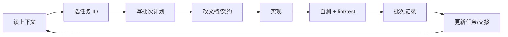

# 07 · 单人 + Agent 工作流

> 本项目是个人开发，不设站会/评审会；但保留**批次、分支、自检、记录**，保证未来自己能接上、agent 能接手。

## 0. 端到端流程



## 1. 批次制

### 1.1 什么是批次

一个批次 = **一个明确目标 + 一组可验收产出 + 0.5–2 天工作量**。

- 批次 ID：`B-001`、`B-002`……；文件名 `B-xxx-<slug>.md`。
- 每批次只做一件事：一个纵向切片、一组文档、一个基础设施改动。
- 批次必须有：目标、范围、非目标、验收标准、依赖、风险。
- 超过 2 天说明拆得不够小；没有验收标准不允许开始。

### 1.2 批次开始前

1. 读 `00-context.md` + `04-tasks.md` + 相关架构节（≤3 份文档）。
2. 在 `08-batch-log/` 复制模板，写清：
   - 目标（一句话）
   - 范围（只改哪些目录/文件）
   - 非目标（明确不做什么）
   - 验收标准（可验证）
   - 计划步骤（3–5 步）
3. 如果涉及 API/数据/目录：先改 `05/06` 和 ADR（如需要），再动代码。
4. 如果需求不清：先写进 `12-open-questions.md`，不要猜。

### 1.3 批次执行中

- 一次只做批次内的事；发现顺手问题，记到 `04-tasks.md`，不顺手改。
- 每完成一个可验证步骤，更新批次记录的“执行记录”。
- 关键命令/输出/截图留证据；不要只写“已测试”。
- 遇到阻塞：在批次记录和 `04-tasks.md` 的阻塞区同时写，不静默跳过。
- 改 API/数据模型：同步 `05-architecture.md`、`contracts/openapi.json`、`packages/contracts`。

### 1.4 批次结束前

- [ ] 验收标准逐项勾选。
- [ ] lint/typecheck/test/build 通过（有输出）。
- [ ] 手动路径走一遍（截图/步骤）。
- [ ] 文档同步：`04-tasks.md`、`08-batch-log/`、`11-handoff.md`。
- [ ] 风险变化写 `09-risks.md`。
- [ ] 没有密钥、调试代码、临时文件进入提交。
- [ ] 下一批次任务已写清。

## 2. Git 工作流

单人项目仍用短分支 + PR 习惯，目的是**可回滚、可追溯**。

### 2.1 分支

```text
main（始终可运行）
  ↑ PR / self-review
feat/<范围>-<简述>
fix/<范围>-<简述>
docs/<简述>
chore/<简述>
ops/<简述>
```

- 从 `main` 拉分支；寿命 ≤ 2 天。
- 不直接 push `main`；合并前自审 diff。
- 合并用 squash merge；合并后删除分支。
- 小文档改动可以合并到一个 docs PR，不按文件拆。

### 2.2 Commit

```text
feat(api): 增加区域排名接口
fix(mp): 修复图表空数据白屏
docs(agent): 更新 API v0
test(api): 补充导入校验测试
chore(ci): 缓存 pnpm 依赖
```

- 一个 commit 只做一件事；不“顺手重构”。
- 提交前跑 lint/format；不提交 `.env`、`console.log`、临时文件。
- 不写“update”“fix bug”这类无信息 message。

### 2.3 PR / 自审

单人项目没有第二人 review，但 PR 描述必须写：

```markdown
## 做了什么

## 为什么

## 怎么验证
- [ ] 命令/测试
- [ ] 手动路径

## 接口/数据变更
- [ ] 无
- [ ] 有（已更新 05/OpenAPI）

## 风险/回滚
```

自审清单：

- [ ] 逻辑/边界：空、超长、重复、未登录、越权。
- [ ] 密钥/敏感信息没有进入代码/日志。
- [ ] API 字段/错误码与 05 一致。
- [ ] 数据库查询没有 N+1/全表扫描；必要索引已加。
- [ ] 前端有 loading/empty/error；AI 失败不白屏。
- [ ] 没有不必要的新依赖。
- [ ] 文件位置/命名符合 06。
- [ ] 测试不是“只测 happy path”。

### 2.4 任务规划与子代理委派（强制）

除单行 typo、配置值等 trivial 修改外，后续任务一律按以下顺序执行：

1. **写计划**：目标、范围、非目标、验收标准、依赖、文件归属、验证方式、风险。
2. **拆工作包**：一个工作包只交付一个可验证结果；优先按端/模块拆分。
3. **委派 subagent**：可并行的独立目录/文件并行委派；共享文件由主 agent 统一修改。
4. **主 agent 集成**：审查 diff、处理契约冲突、合并代码。
5. **主 agent 复跑验证**：lint/test/build/手动路径；不能只看子代理自述。
6. **留痕**：更新任务、批次记录、交接文档、OpenAPI/架构文档。

工作包最小字段：

```text
TASK:
WORK PACKAGE:
FILES YOU OWN:
FILES YOU MUST NOT TOUCH:
GOAL:
ACCEPTANCE:
MUST DO:
MUST NOT DO:
CONTEXT:
VERIFY:
HANDOFF:
```

规则：

- 子代理不得直接 commit/push；合并与提交由主 agent 执行。
- 子代理不得修改 `Resource/`、提交密钥、扩大任务范围。
- 工作包之间不得同时修改同一文件；共享文件（router、models `__init__`、OpenAPI、05 文档）由主 agent 处理。
- 主 agent 必须检查：是否越界改文件、是否真的跑测试、是否引入新依赖、是否更新文档、是否可复现。
- 详细示例见 `docs/agent/20-b002-delegation-plan.md`。

## 3. Definition of Done

一个任务只有满足以下条件才算 DONE：

1. 代码实现并本地运行。
2. 必要测试通过（后端 service/API；前端关键组件/E2E）。
3. lint/typecheck/build 通过。
4. 文档同步（API/数据/页面/任务/批次）。
5. 手动验证有记录（命令输出/截图/步骤）。
6. 没有密钥、调试代码、无意义日志。
7. 可回滚：知道改了什么、怎么退。
8. 若由 subagent 实现：主 agent 已审查 diff 并复跑验证，子代理自述不能代替验收。

## 4. 文档同步矩阵

| 改动 | 必须同步 |
|---|---|
| API 路径/字段/错误码 | `05-architecture.md`、`contracts/openapi.json`、`packages/contracts` |
| 数据表/字段/迁移 | `05-architecture.md` §5、`06-file-tree.md`（新增目录时） |
| 新页面/组件 | `06-file-tree.md`、`docs/product/03-page-specs.md` |
| 任务完成/阻塞 | `04-tasks.md`、当前批次记录 |
| 范围变化 | `01-project.md`、`02-goals.md`、ADR |
| 技术选型/不可逆决策 | `docs/adr/` 新增 ADR |
| 新风险 | `09-risks.md` |
| 进度/交接 | `11-handoff.md`、`00-context.md`（阶段变化时） |

## 5. 验证与证据

没有证据 = 没完成。最低要求：

| 改动类型 | 证据 |
|---|---|
| 后端 | `ruff check`、`pytest` 输出；接口 curl/httpx 示例 |
| 前端 | `lint`、`typecheck`、`build`；页面截图/录屏 |
| 原生小程序 | 微信开发者工具打开/构建；关键页面截图 |
| 数据库 | `alembic upgrade head` + 回滚；查询结果 |
| AI | 评测集跑分；一次真实问答记录（脱敏） |
| 部署 | 访问地址、健康检查、日志片段 |
| 文档 | 链接检查、无 emoji 检查、目录树、关键文件存在 |

## 6. Agent 使用规则

### 6.1 适合交给 agent

- 有明确验收的纵向切片（一个接口 + 页面 + 测试）。
- 文档整理/摘要/链接检查。
- 重复性脚手架、类型生成、迁移草稿。
- 代码审查/风险扫描（只读）。

### 6.2 不适合交给 agent

- 需求未定、范围模糊的“大功能”。
- 需要真实数据/真实账号/外部审批的验证。
- 涉及密钥、生产环境、数据库破坏性操作。
- 需要审美判断的高保真设计（可让 agent 出初稿，人来定）。

### 6.3 给 agent 的任务描述

必须包含：任务 ID、目标、范围、非目标、验收标准、相关文件、已知风险、禁止事项。

示例：

```text
任务：DATA-005 Excel 导入器 + 校验
范围：只改 services/api/app/services/import_service.py、schemas/import.py、tests/unit/test_import.py
不做：不改前端、不改数据模型、不做地图
验收：原始模板 1609 行可导入；错误行有 row/column/code；重复导入更新；测试通过
禁止：不写死真实数据；不在日志打印完整数据；不引入 pandas
```

### 6.4 agent 交付后必须检查

- 是否按范围改文件？有没有顺手改别的？
- 是否真的跑了测试/构建？输出是否可信？
- 是否引入新依赖/新目录？
- 是否把密钥/真实数据写进代码？
- 是否更新了文档/任务/批次记录？
- 结果是否可复现？

## 7. 上下文管理

- 单次任务读 ≤3 份文档；不要全量加载。
- 长文档按节读：`05` 的技术栈/数据/API/Agent；`04-data-catalog` 的指标/区域。
- 新会话先复述，再动手；复述错说明上下文没加载对。
- 每批次结束更新 `11-handoff.md`，让下一个会话不用重读全部。
- 对话里产生的决策，落到 ADR/文档；不要只留在聊天记录。

## 8. CI

最小流水线（B-002 建立）：

```text
PR:
  - docs link check（可选）
  - api: ruff check + pytest
  - admin: lint + typecheck + build
  - mp: lint + typecheck + build:h5（+ build:mp-weixin）
```

- 不把真实 LLM 调用放进 CI；用 mock。
- 不把数据库密码写进 CI 明文；用服务容器/测试库。
- CI 失败优先修，不跳过。

## 9. 版本与发布

- 版本号：`0.x.y`；M0 为 `0.1.0`，M1 为 `0.2.0`，以此类推（P1 可调整）。
- 每个里程碑打 tag：`v0.1.0`、`v0.2.0`。
- 发布记录写：新增/变更/修复/已知问题/回滚方式。
- 演示环境与生产环境分开；演示数据明确标注“演示”。

## 10. 复盘

每批次结束用 5 分钟回答：

1. 目标达到了吗？验收标准过了吗？
2. 哪些动作浪费了时间？
3. 哪个决策需要写 ADR/改文档？
4. 下一个批次是什么？依赖什么？
5. 风险有没有变化？

每 4–6 个批次做一次“范围审计”：是否偏离 P0？是否该砍功能？
