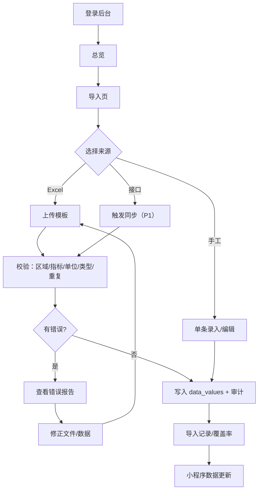
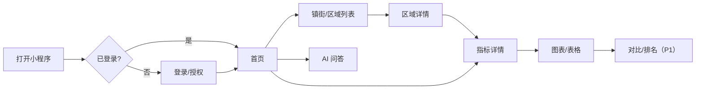
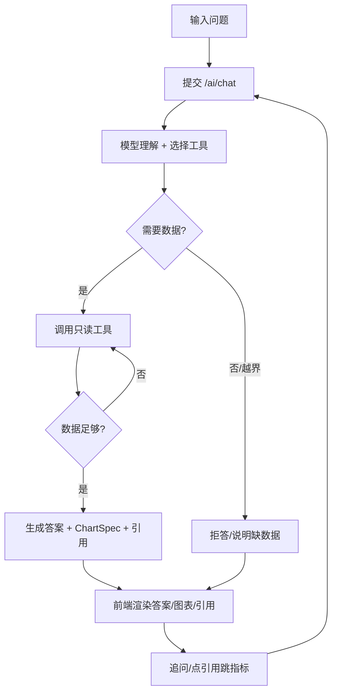
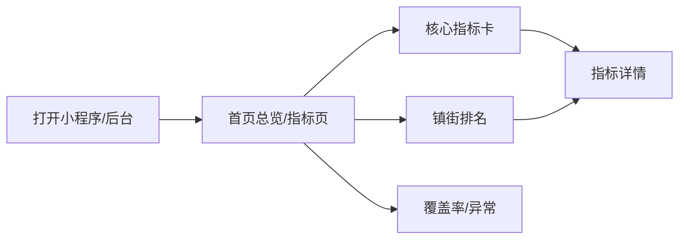
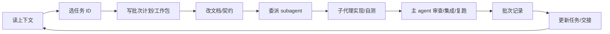
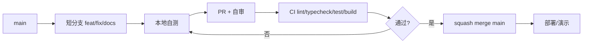
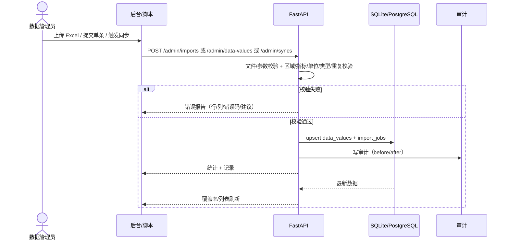
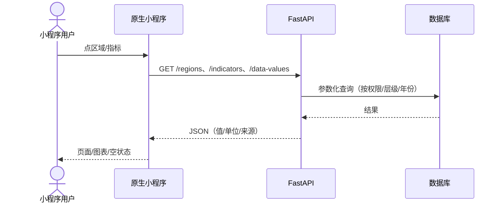
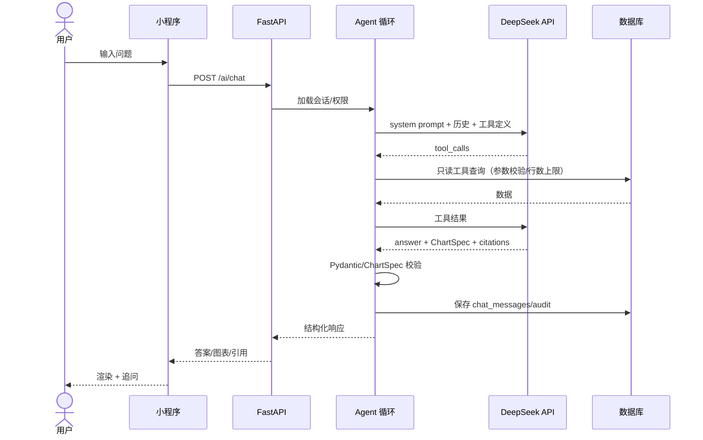
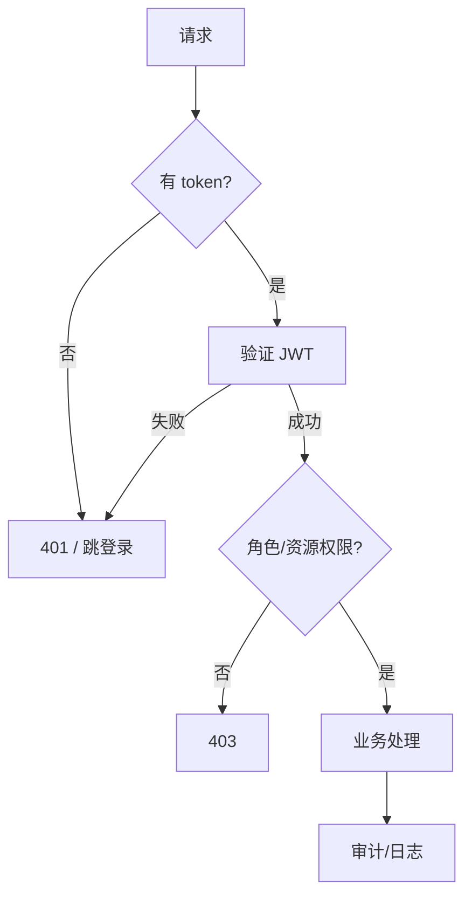

# 18 · 三类工作流

> 本文件把 **用户工作流、开发工作流、系统工作流** 放在一起，作为页面设计、接口设计和批次排期的共同依据。
> 页面级细节见 `docs/product/05-page-structure.md`；技术契约见 `05-architecture.md`。

## 1. 用户工作流

### 1.1 角色

| 角色 | 入口 | 主要任务 | 权限 |
|---|---|---|---|
| 数据管理员 | Web 后台 | 导入/修订数据、看导入记录、审计 | admin/editor |
| 公职人员 | 原生微信小程序（后续粤政易工作台） | 看区域/指标/图表、问数据 | viewer（或 guest 游客只读，已确认） |
| 领导/决策者 | 小程序/后台 | 看总览、排名、对比；复用统一页面；不单独开发模式 | viewer（只读）+ 导出汇报卡 |
| AI 问答使用者 | 小程序 | 自然语言查数据、看图表/引用 | viewer |
| 粤政易/政数管理员 | 粤政易管理中心 | 开通可见人员、配置入口（后期） | 平台侧 |

### 1.2 U1：数据管理员导入/更新数据

关键规则：

- 每次导入/同步形成一批 `import_jobs`；记录操作者、统计、错误。
- 默认 `atomic`：有错误整批不写；修正后重试。
- 重复导入按 `(region, indicator, period)` upsert，不产生重复行。
- 空值 = 无数据，不写 0；文本指标不参与排名/数值图表。

### 1.3 U2：公职人员浏览数据

关键规则：

- 首页到指标 ≤3 次点击；指标详情必须显示单位/年份/来源。
- 区域详情只显示该区域适用指标；不适用不显示或“无数据”。
- 图表无数据时显示空状态，不画 0；图表失败降级表格。

### 1.4 U3：AI 问答

关键规则：

- 最多 5 次工具调用；最多 500 行；30s 超时。
- 答案必须带 `citations`（指标/区域/年份/来源）；无数据明确说明。
- 图表只由后端 `ChartSpec` 生成；前端固定渲染，不执行模型生成的 JS/option。
- 问答记录落 `chat_messages` + `audit_logs`；不记录密钥。

### 1.5 U4：领导审阅场景（P1，复用统一页面，不单独开发模式）

> 不新增“领导模式”页面或入口；领导使用的仍是统一首页、区域页、指标页，差异仅在只读权限和“导出汇报卡”动作。

## 2. 开发工作流

> 详细规则见 [07-workflow.md](07-workflow.md)；这里是总览。

### 2.1 批次生命周期

> 非简单任务按 `07-workflow.md` §2.4 拆工作包并委派 subagent；主 agent 不能只转述子代理结果，必须复跑验证。

### 2.2 Git/CI

规则：

- `main` 始终可运行；不直接 push。
- 分支 ≤2 天；一个 PR 只做一件事；<400 行 diff。
- 提交前跑 lint/format/test；不提交密钥/调试代码。
- 每批次更新 `04-tasks.md`、`08-batch-log/`、`11-handoff.md`。

### 2.3 11.12 冲刺专用节奏

| 日期 | 开发动作 | 验证 |
|---|---|---|
| 11.06 | 脚手架 + SQLite + 原生小程序空壳 | `/health`；开发者工具打开 |
| 11.07 | 模型/迁移/种子/导入/查询 API | 1608 行模板可导入 |
| 11.08 | 小程序首页/区域/指标 | 区→镇街→指标可走通 |
| 11.09 | 图表 + 后台最小 | 图表可渲染；后台可看数据 |
| 11.10 | DeepSeek + 工具 + 问答页 | 3 个问题可答 |
| 11.11 | 联调/修 bug/文档/成本 | demo 脚本 3/3 |
| 11.12 | 缓冲/彩排/交付 | 按 `15-demo-plan-1112.md` 验收 |

## 3. 系统工作流

### 3.1 数据接入（Excel/接口/手工）

### 3.2 数据查询

### 3.3 AI 问答

### 3.4 认证与权限

- 后台：JWT + RBAC（六类身份；见 `05` §9 与 `23`）。
- 小程序：微信登录（后期）/测试号/模拟登录；粤政易 SSO 后置。
- AI 工具按用户可见范围过滤；不返回越权区域。

### 3.5 审计

| 事件 | 记录 |
|---|---|
| 登录成功/失败 | user、ip、ua、结果 |
| 导入/同步 | 文件/来源、统计、错误摘要 |
| 数据修改 | before/after、操作者 |
| AI 问答 | 问题摘要、工具调用、耗时、token、结果状态 |
| 权限变更 | 目标用户、角色变化 |

## 4. 数据对象与接口映射

| 对象 | 关键字段 | 主要接口 | 页面 |
|---|---|---|---|
| Region | id/code/name/level/parent_id | `GET /regions`、`/regions/{id}` | MP-02/03、AD-03 |
| Indicator | id/code/name/unit/value_type | `GET /indicators` | MP-03/04、AD-03 |
| DataValue | region_id/indicator_id/period/value | `GET /data-values`、`/data-values/rank`、`/data-values/compare` | MP-04、AD-03/04 |
| ImportJob | job_type/status/errors | `POST /admin/imports`、`GET /admin/imports` | AD-05/06 |
| ChatMessage | role/content/chart_spec/citations | `POST /ai/chat`、`GET /ai/sessions/{id}/messages` | MP-05/06 |
| AuditLog | action/resource/detail | `GET /admin/audit-logs` | AD-07 |

## 5. 异常与边界

| 场景 | 行为 |
|---|---|
| 导入有错误 | 默认整批不写；返回行/列/错误码/建议；修正后重试 |
| 重复导入 | 按唯一键 upsert；提示更新数量 |
| 无数据 | 显示“当前没有该指标/年份数据”；不画 0 |
| 区域名称不一致 | 别名表映射；无法匹配则报错，不模糊匹配 |
| AI 无数据 | 明确拒答/说明缺什么；不编造 |
| AI 超时/额度 | 可重试；缓存/预生成答案兜底 |
| 未登录/越权 | 401/403；不泄露资源存在性 |
| 图表失败 | 降级表格；可重试 |
| 弱网 | loading/重试；保留已输入内容 |

## 6. 待确认

1. 已确认（2026-11-10）：后台批量建号 + 小程序申请 + 游客只读；微信登录/粤政易 SSO 后置。
2. 已确认（2026-11-10）：游客只读开放；游客不可导出；申请者只看申请状态。
3. 后台角色已确认覆盖六类身份（见 `05` §9、`12` §0.3）。
4. 接口同步的数据源/协议/频率？
5. 粤政易 SSO/工作台入口的接入时间与网络。

> 对外问法见 [17-outreach-copy.md](17-outreach-copy.md)；页面地图见 [05-page-structure.md](../product/05-page-structure.md) 与 [ue/page-map.html](../product/ue/page-map.html)。
