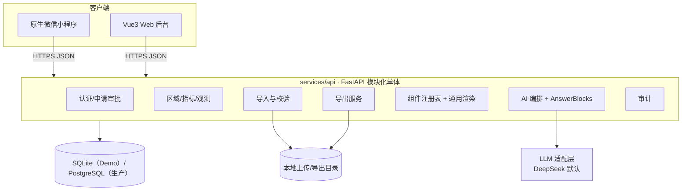

# 21 · 技术架构 v2（契约草案，待实现）

> 本文是 [05-architecture.md](05-architecture.md) 的下一版草案，**不替代 05**。主 agent 评审后把摘要合并回 05，接口以代码生成的 `contracts/openapi.json` 为准。
> 标记“待定”的条目不得作为验收依据。本文不声称任何代码、表或接口已经存在。

## 0. 相对 05 的变更摘要

| 领域 | 05 现状 | v2 变化 | 原因 |
|---|---|---|---|
| 数据模型 | 区域/指标/数据值 + 来源/批次/审计 | 增加 periods、dimensions、indicator_dimensions、derived_metrics、observations（由 data_values 扩展）、import_rows、data_quality_issues、answer_blocks、component_registry、export_jobs | 支持多期、多维、派生指标、可解释答案 |
| 值类型 | number / text | 12 种值类型 + 单位/精度/聚合元数据 | 模板全覆盖且可扩展 |
| API | v0 基础端点 | 增加 periods、组件、导出、申请审批、聊天日志端点；统一分页与幂等 | 契约完整化 |
| 认证 | 登录 + RBAC | 后台批量建号 + 小程序申请 + 游客模式 + 移动端审批子集 | 已确认决策 |
| AI 输出 | answer_markdown + ChartSpec | AnswerBlocks + 组件注册表 + 通用渲染器 | 答案结构化、可审计 |
| 导出 | P1 | PNG/PDF/XLSX/CSV，必须显式选择，游客禁止 | 已确认决策 |
| 实时性 | 未定义 | 读取“最新已发布版本”，不做流式 | 已确认决策 |

## 1. 目标、范围、非目标与假设

### 1.1 目标

1. 11.12 交付**可运行 Demo v0**：一台小服务器部署，微信小程序真机/开发者工具可测，Web 后台可视化可操作。
2. 用确定性合成演示数据跑通“导入 → 存储 → 查询/图表 → AI 问答 → 导出”的完整闭环。
3. 数据契约覆盖现有 15 指标模板，同时为多期、多维、派生指标、地理与附件预留扩展位。
4. 所有写操作可审计，所有 AI 结论可引用，所有导出有权限控制。

### 1.2 范围

- 本文定义 Demo v0 与 M1 的目标模型、接口和组件边界。
- Demo v0 只实现第 3.2 节的表子集与第 5.2 节的 P0 端点。
- 真实数据到位后按同一契约导入，不需要改表结构。

### 1.3 非目标

1. 不做微服务拆分、消息队列、流式推送、实时数据管道。
2. 不在运行时从远端动态加载组件代码。
3. 不允许 LLM 生成 SQL、JavaScript 或 ECharts option。
4. 不做独立“领导模式”或独立领导页面。
5. 本期不做公众开放 API、多租户、模型训练。

### 1.4 假设

| 编号 | 假设 | 影响 |
|---|---|---|
| A-01 | 演示阶段数据为非密、非敏感统计数据 | 允许使用公有云 LLM |
| A-02 | 真实数据后续由需求方按模板提供 | 先用合成数据，导入器按模板开发 |
| A-03 | GDP 排名不是必需功能 | 排名能力保留，但不作为验收门槛 |
| A-04 | 演示服务器为 2 核 4GB 级别 | 不引入额外中间件 |
| A-05 | 小程序通过已备案域名访问后端 | 需配置 request 合法域名与 HTTPS |

## 2. 总体架构



| 组件 | 职责 | Demo v0 | M1 起 |
|---|---|---|---|
| 客户端 | 小程序浏览/问答；后台管理/审批 | 均可用，后台可视化 | 体验与权限细化 |
| 模块化单体 | 单 FastAPI 进程，按 `app/api`、`app/services`、`app/ai` 分层 | 是 | 保持单体 |
| 数据库 | 同一套 SQLAlchemy 模型，SQLite ↔ PostgreSQL | SQLite + WAL | PostgreSQL 16 |
| AI 适配层 | `LLM_PROVIDER/BASE_URL/KEY/MODEL` 配置化，OpenAI 兼容 | DeepSeek；无 Key 用预生成 | 可切政务云/私有化 |
| 导出服务 | 统一生成 PNG/PDF/XLSX/CSV，落 `export_jobs` | PNG/PDF/XLSX/CSV + 水印 | 异步队列、对象存储、版式增强 |
| 组件注册表 | 组件元数据 + props 契约，静态实现 | 代码内 JSON 注册表 | 持久化 `component_registry` |
| 审计 | 写操作、导入、导出、AI 调用留痕 | 是 | 保留期与检索增强 |

## 3. 数据模型

### 3.1 目标表清单

| 表 | 作用 | 关键字段与约束 |
|---|---|---|
| `regions` | 区域树 | `code` 唯一；`level`(district/town/village)；`category`(administrative/development_zone)；`parent_id`；`external_code` 预留 |
| `region_aliases` | 导入别名 | `(region_id, alias)` 唯一；先录 `玉窖镇 → 玉滘镇` |
| `periods` | 数据期 | `period_type`；`period_key` 唯一（如 `2025`、`2025Q1`）；`start_date`/`end_date` |
| `indicators` | 指标注册表 | `code` 唯一；`unit_code`；`value_type`；`applicable_levels`；`aggregation`；`precision`；`max_length` |
| `dimensions` | 维度字典 | `code`、`name`、`dim_type`、`value_domain`(JSON) |
| `indicator_dimensions` | 指标可用维度 | `(indicator_id, dimension_id)` 唯一；`required`、`default_value` |
| `observations` | 观测值（由 `data_values` 扩展） | `(region_id, indicator_id, period_id, dimension_hash)` 唯一；`quality_status`；`version`；`status` |
| `datasets` / `dataset_items` | 指标分组、看板数据集 | 组内指标排序；别名 `indicator_groups` |
| `derived_metrics` | 派生指标 | `code`、`formula`(DSL)、`unit_code`、`precision`、`dependencies`(JSON) |
| `data_sources` | 数据来源 | `source_type`(manual/excel/api/demo)；`owner` |
| `import_jobs` | 导入批次 | `status`、`mode`(atomic/partial)、行数统计、错误摘要 |
| `import_rows` | 行级结果 | `job_id`、`row_number`、`raw`、`normalized`、`error_code`、`observation_id` |
| `data_quality_issues` | 质量问题 | `code`、`severity`、`subject_type/id`、`status`(open/resolved/waived) |
| `users` | 用户 | `username` 唯一；`role`；`status`；`wechat_openid` 唯一可空 |
| `user_applications` | 小程序使用申请 | `status`(pending/approved/rejected)；`reviewed_by`；`reviewed_at` |
| `audit_logs` | 审计 | `action`、`resource_type/id`、`detail`(before/after)、`request_id` |
| `chat_sessions` / `chat_messages` | 问答会话 | `role`、`tool_calls`、`blocks`、`model`、`token_usage` |
| `answer_blocks` | 结构化答案块 | `message_id`、`block_type`、`payload`(JSON)、`order` |
| `component_registry` | 组件元数据 | `key` 唯一、`props_schema`、`data_contract`、`platforms`、`status` |
| `export_jobs` | 导出任务 | `format`、`target`、`params`、`status`、`file_path`、`expires_at` |

### 3.2 Demo v0 表子集

Demo v0 只建：`regions`、`region_aliases`、`indicators`、`observations`（物理表名沿用 `data_values`，契约名 `observations`）、`data_sources`、`import_jobs`、`users`、`user_applications`、`chat_sessions`、`chat_messages`、`export_jobs`、`audit_logs`，共 12 张表。

- `periods`、`dimensions`、`indicator_dimensions`、`derived_metrics`、`import_rows`、`data_quality_issues`、`answer_blocks`、`component_registry` 的**字段**在 Demo v0 中先以列或 JSON 形式预留（如 `period_year`/`period_type`、`chat_messages.blocks`、代码内组件注册表），M1 再拆表。
- Demo v0 查询参数使用 `period_year`（如 `2025`），不暴露 `period_key`；M1 建 `periods` 后统一为 `period_key`。
- Demo v0 建最小 `export_jobs`，状态可为 `queued`/`running`/`ready`/`failed`/`expired`，用于多格式导出与产物下载；AD13 导出任务列表 UI 仍为 P1。

### 3.3 值类型

| value_type | 存储列 | 校验 | 示例 |
|---|---|---|---|
| `text` | `value_text` | 长度 ≤ `max_length`（默认 500） | 区域名称 |
| `long_text` | `value_text` | 长度 ≤ `max_length`（默认 5000） | 地区简介（150）、地区特色（300） |
| `integer` | `value_number` | 必须整数 | 行政村数量 |
| `decimal` | `value_number` | NUMERIC(18,4) | 区域面积 |
| `currency` | `value_number` | NUMERIC(18,2)，单位由 `unit_code` 决定 | 地区生产总值 |
| `percentage` | `value_number` | 0–100，单位 `%` | 覆盖率 |
| `ratio` | `value_number` | NUMERIC(18,6) | 人均比值 |
| `boolean` | `value_bool` | true/false | 是否开发区 |
| `date` | `value_date` | ISO 8601 日期 | 统计截止日 |
| `json` | `value_json` | 合法 JSON | 扩展结构 |
| `geo` | `value_json` | GeoJSON 几何，M1 | 边界 |
| `attachment` | `value_json` | 文件元数据 + 受控路径，M1 | 佐证材料 |

### 3.4 单位

| unit_code | 显示 | 类型 |
|---|---|---|
| `text` | 文本 | 无量纲 |
| `person` | 人 | 计数 |
| `household` | 户 | 计数 |
| `count` | 个 | 计数 |
| `km2` | 平方公里 | 面积 |
| `mu` | 亩 | 面积 |
| `yi_yuan` | 亿元 | 金额 |
| `wan_yuan` | 万元 | 金额 |
| `percent` | % | 比率 |
| `ratio` | 倍 | 比率 |
| `year` | 年 | 时间 |
| `custom` | 自定义 | 需在指标上写 `unit_label` |

当前模板只出现 6 种单位：文本、平方公里、个、人、亩、亿元。

### 3.5 数据期

`period_type`：`year`、`half_year`、`quarter`、`month`、`day`、`point`（时点快照）。
`period_key` 规范化：`2025`、`2025H1`、`2025Q1`、`2025-03`、`2025-03-31`。Demo v0 只写入 `year` 且值为 `2025`，查询参数用 `period_year`；M1 建 `periods` 后改用 `period_key`。

### 3.6 维度与 dimension_hash

维度以 JSON 对象表示，区域不入维度（区域由 `region_id` 独立表达）：

```json
{"gender": "total", "industry": "manufacturing", "stat_caliber": "registered"}
```

- 规范化：键按字典序排序、UTF-8、无多余空白，再做 SHA-256，得到 `dimension_hash`。
- 唯一键 `(region_id, indicator_id, period_year, period_type, dimension_hash)`；无维度时 Demo v0 使用空字符串 `''`，M1 改为固定 SHA-256 常量。
- 维度键必须在 `dimensions` 注册；值必须落在 `value_domain` 内；非法维度拒绝写入。
- Demo v0 等价于“单维度全量”，`dimension_hash` 恒为空字符串。

### 3.7 质量状态

| quality_status | 含义 | 查询/图表处理 |
|---|---|---|
| `missing` | 应报未报 | 不参与排名；图表标注“缺失” |
| `not_applicable` | 该区域/层级不适用 | 不展示；不计入覆盖率分母 |
| `suppressed` | 因保密/样本量被抑制 | 不展示数值，仅显示“已抑制” |
| `estimated` | 估算值 | 展示并标注“估算” |
| `provisional` | 初步数/快报数 | 展示并标注“初步” |
| `verified` | 已核定 | 正常展示 |

空值仍用 NULL 表示，不用 0；`quality_status` 与空值可组合使用。

### 3.8 派生指标公式 DSL

```text
expr      := number | indicator_ref | func "(" args ")"
func      := sum | avg | min | max | ratio | share | diff | growth | per_capita
indicator_ref := 指标 code，可带 period 偏移与 level 过滤
```

规则：

1. 白名单函数与运算符，禁止赋值、循环、IO、任意代码。
2. 由后端编译为受限 AST 并求值；LLM 只能引用 `derived_metrics.code`，不接触公式文本。
3. 保存时做语法、依赖存在性、循环依赖、层级/单位一致性校验；失败返回 `DERIVED_METRIC_INVALID`。
4. 结果带 `dependencies` 与数据版本，输入版本变化即失效重算。
5. 示例：`per_capita(gdp, population_resident)`、`share(gdp, sum(gdp, level=town))`、`growth(gdp, 2025, 2024)`。

### 3.9 从 ADR-002 迁移

| 步骤 | 动作 | 兼容性 |
|---|---|---|
| 1 | Demo v0 保留 `data_values` 表名，增加 `quality_status`、`dimension_hash`、`import_job_id`、`version` 可空列 | 旧读写路径不变 |
| 2 | 建 `periods`，由 `(period_year, period_type)` 回填，新增 `period_id` 并双写 | 两套字段并存 |
| 3 | 回填 `dimension_hash` 为常量；唯一键保持 `(region_id, indicator_id, period_year, period_type)` | 不破坏约束 |
| 4 | 切换唯一键为 `(region_id, indicator_id, period_id, dimension_hash)`，改名 `observations`（Alembic batch 模式，兼容 SQLite） | 需迁移测试 |
| 5 | 下线 `period_year`/`period_type` 影子列 | 回归通过后执行 |

迁移期间所有写入走同一 service，禁止直接按表名拼 SQL。

## 4. 数据接入

| 来源 | 入口 | 说明 |
|---|---|---|
| Excel v1 | `POST /admin/imports` | 原始 6 列模板，P0 |
| Excel v2 | 同上 | 增加可选列：指标编码、维度列、数据来源、质量状态、备注 |
| 手工录入 | `POST/PATCH /admin/data-values` | 单条补录/修正，P0 最小 |
| 接口同步 | `POST /admin/syncs`（P1） | 拉取或推送，复用同一校验与写库逻辑 |
| 合成演示数据 | `scripts/seed_demo.py` | 确定性、显式标注，不得与真实数据混淆 |

批次规则：

1. 每次导入/同步形成 `import_jobs`，记录来源、操作者、模式、行数、耗时。
2. 校验顺序：文件 → 表头 → 区域 → 指标/单位/适用性 → 值类型/长度 → 维度 → 数据期 → 文件内重复。
3. 默认 `atomic`：任一行错误则整批不写；`partial` 为显式选项，写入通过行并标记失败行。
4. 按唯一键 upsert：`version + 1`、更新 `updated_by/updated_at`，`audit_logs.detail` 存 before/after。
5. 行级结果写 `import_rows`（Demo v0 写 JSON 错误报告）；重复导入同一文件产生新批次，不覆盖历史批次。
6. 血缘：`observations.import_job_id + source_id`；文件保留策略与错误报告路径写入批次记录。

## 5. API v0

### 5.1 约定

- Base：`/api/v1`；JSON UTF-8；上传 `multipart/form-data`。
- 成功：`{"data": ..., "meta": {"request_id": "...", "page": 1, "page_size": 20, "total": 0, "has_next": false, "warnings": []}}`
- 失败：`{"error": {"code": "...", "message": "...", "details": {}}, "request_id": "..."}`
- 分页：`page` 从 1 开始，`page_size` 默认 20、最大 100；列表端点必须返回 `meta.total`。
- 时间：ISO 8601；Demo v0 查询参数用 `period_year`，M1 数据期用 `period_key`；数值不带单位，单位由指标给出。
- 写接口支持 `Idempotency-Key` 头，窗口 24 小时；重复键返回首次结果。
- 数据读取一律取“最新已发布版本”（`status=published`），不做流式推送；`meta.data_version` 标识当前版本。

### 5.2 端点

> 2026-11-10 实现状态：B04 查询 + B05 认证/申请/审批/用户/审计/导入 + B08 AI/导出已落地；OpenAPI 35 paths。Demo v0 查询参数用 `period_year`/`root_code`；导出同步生成并返回 `ready`。

| 方法 | 路径 | 说明 | 角色 |
|---|---|---|---|
| GET | `/health` | 进程存活，不查库 | 公开 |
| GET | `/ready` | DB/配置就绪 | 公开 |
| POST | `/auth/login` | 用户名/密码 → access token | 公开 |
| GET | `/auth/me` | 当前用户与角色 | 登录 |
| POST | `/auth/apply` | 小程序提交使用申请 | 登录（未授权亦可） |
| GET | `/auth/application-status` | 查询本人申请状态 | 登录 |
| GET | `/regions` | `level`、`parent_id`、`q`、`category` | guest+ |
| GET | `/regions/tree` | Demo v0 用 `root_code`、`depth`（默认 2）；M1 增加 `root_id` | guest+ |
| GET | `/regions/{id}` | 区域详情 + 父级 | guest+ |
| GET | `/regions/{id}/profile` | 文本简介/特色 + 关键指标 | guest+ |
| GET | `/indicators` | `level`、`category`、`value_type` | guest+ |
| GET | `/indicators/{id}` | 指标口径、单位、适用性 | guest+ |
| GET | `/periods` | 可用数据期 | guest+ |
| GET | `/data-values` | `region_id`、`indicator_code`、`period_key`、`quality_status` | guest+ |
| GET | `/data-values/compare` | `indicator_code`、`region_ids`（≤20）、`period_key` | guest+ |
| GET | `/data-values/rank` | `indicator_code`、`period_key`、`level`、`order`、`limit`（≤50） | guest+ |
| GET | `/dashboard/overview` | `period_key`：核心指标、镇街概览、覆盖率 | guest+ |
| POST | `/ai/chat` | 提问 → AnswerBlocks + 引用 | guest+（限流） |
| GET | `/ai/sessions` | 本人会话 | 登录 |
| GET | `/ai/sessions/{id}/messages` | 会话消息 | 登录 |
| GET | `/components` | 组件元数据列表 | 登录 |
| GET | `/components/{key}` | 单组件契约 | 登录 |
| POST | `/exports` | 显式 `format` 创建导出 | viewer+ |
| GET | `/exports/{id}` | 导出状态/下载地址 | 本人 |
| POST | `/admin/imports` | 上传 Excel；`mode` | editor+ |
| GET | `/admin/imports` / `/{id}` | 批次列表/详情 | editor+ |
| GET | `/admin/imports/{id}/errors` | 错误报告 | editor+ |
| GET/POST/PATCH | `/admin/data-values` | 管理端查询/新增/修改 | editor+ |
| GET | `/admin/applications` | 申请队列 | approver+ |
| POST | `/admin/applications/{id}/approve` | 通过 | approver+ |
| POST | `/admin/applications/{id}/reject` | 驳回 | approver+ |
| GET/POST/PATCH | `/admin/users` | 用户列表/批量导入/启停 | admin |
| GET | `/admin/audit-logs` | 审计检索 | admin |
| GET | `/admin/chat-logs` | 问答与工具调用记录 | admin |
| GET/POST/PATCH | `/admin/components` | 组件注册表维护 | admin |

### 5.3 角色与权限

| 角色 | 浏览/图表 | AI 问答 | 导出 | 写数据 | 审批 | 系统管理 |
|---|---|---|---|---|---|---|
| `guest` 游客 | 是（已发布数据） | 是（限额） | 否 | 否 | 否 | 否 |
| `applicant` 申请者 | 否 | 否 | 否 | 否 | 否 | 否 |
| `viewer` 查看者 | 是 | 是 | 是 | 否 | 否 | 否 |
| `editor` 编辑者 | 是 | 是 | 是 | 是（数据/导入） | 否 | 否 |
| `approver` 审批者 | 是 | 是 | 是 | 否 | 是（移动端子集） | 否 |
| `admin` 管理员 | 是 | 是 | 是 | 是 | 是 | 是 |

- 移动端审批子集：待办列表、申请者详情、通过、驳回、备注；不做用户删除、角色变更、批量导入。
- 游客永不可导出；`POST /exports` 对 guest/applicant 返回 403。

### 5.4 错误码（v2 新增，基础项见 05 §6.3）

| code | HTTP | 说明 |
|---|---|---|
| `ACCOUNT_DISABLED` | 403 | 账号被停用 |
| `APPLICATION_PENDING` | 403 | 申请审核中，仅可浏览 |
| `APPLICATION_REJECTED` | 403 | 申请被驳回 |
| `EXPORT_FORBIDDEN` | 403 | 游客/申请者/越权用户不可导出 |
| `EXPORT_FORMAT_REQUIRED` | 422 | 未显式指定导出格式 |
| `EXPORT_FORMAT_UNSUPPORTED` | 422 | 格式不在 PNG/PDF/XLSX/CSV |
| `EXPORT_FAILED` | 500 | 导出生成失败 |
| `IMPORT_TOO_LARGE` | 413 | 文件超过 10MB |
| `IMPORT_ROW_LIMIT` | 422 | 数据行超过 5000 |
| `PERIOD_INVALID` | 422 | 数据期格式或取值非法 |
| `DIMENSION_INVALID` | 422 | 维度未注册或取值越界 |
| `DERIVED_METRIC_INVALID` | 422 | 公式语法/依赖/单位校验失败 |
| `COMPONENT_NOT_FOUND` | 404 | 组件 key 不存在或已停用 |
| `AI_NO_DATA` | 200 | 无数据拒答（业务码，非失败） |
| `AI_TOOL_LIMIT` | 200 | 工具调用次数用尽，返回已有结论 |
| `IDEMPOTENCY_CONFLICT` | 409 | 同一幂等键请求体不一致 |
| `NOT_READY` | 503 | 就绪检查失败 |
| `INDICATOR_NOT_NUMERIC` | 422 | 文本指标不支持排名/对比 |
| `REGION_NOT_FOUND` | 404 | 对比/导入中区域不存在 |
| `COMPARE_REGION_COUNT_INVALID` | 422 | 对比区域数不在 2–20 |
| `DATA_VERSION_CONFLICT` | 409 | 基于旧版本修改 |

## 6. 认证与申请流程（摘要）

```text
后台批量建号：管理员导入用户 CSV/XLSX → 生成初始口令或邀请 → 首次登录强制改密
小程序申请：wx.login → openid → 提交姓名/单位/事由 → pending
审批：approver（含移动端）→ approved 自动授予 viewer；rejected 保留原因
游客模式：不登录可浏览已发布数据与限额问答；不可导出、不可写入
```

- 密码 argon2id；JWT HS256，`sub/role/exp`；AppSecret 仅服务端保存。
- 所有审批动作、账号启停、批量导入写审计。
- 详细流程、状态机与字段见 `23-auth-and-application.md`（计划文档，待建）。

## 7. AI（AnswerBlocks）

```json
{
  "blocks": [
    {"type": "text", "text": "2025 年揭东区地区生产总值为……"},
    {"type": "metric", "indicator": "gdp", "region": "JD", "period": "2025", "value": 123.4, "unit": "亿元"},
    {"type": "chart", "spec": {"version": "1.0", "type": "hbar"}},
    {"type": "citations", "items": [{"indicator": "gdp", "period": "2025", "source": "observations"}]},
    {"type": "notice", "level": "info", "text": "当前为演示数据"},
    {"type": "follow_up", "items": ["要看人均吗？"]}
  ]
}
```

| block_type | 用途 | 渲染 |
|---|---|---|
| `text` | 结论/说明 | Markdown 安全子集 |
| `metric` | 单个数值卡 | 静态指标卡组件 |
| `chart` | ChartSpec | 通用图表渲染器 |
| `table` | 表格数据 | 通用表格组件 |
| `citations` | 数据依据 | 引用列表组件 |
| `notice` | 提示（演示数据/估算/抑制） | 提示条组件 |
| `follow_up` | 追问建议 | 快捷问题组件 |

工具白名单（只读，全部参数校验并限行）：`list_regions`、`list_indicators`、`list_periods`、`get_indicator_values`、`rank_regions`、`compare_regions`、`get_region_profile`、`get_derived_metric`、`build_chart`。

规则：

1. 最多 5 次工具调用、单次返回 ≤500 行、30 秒超时、答案 ≤2000 字。
2. 无数据必须拒答（`AI_NO_DATA`），不得推测、补零或跨期替代。
3. 每个结论必须有引用；引用缺失视为输出非法，重试一次仍失败则返回 `AI_INVALID_OUTPUT`。
4. 演示数据命中时自动追加 `notice`，导出的图片/文件同样带“演示数据”标识。
5. 不做流式响应；前端用加载态与分步提示。
6. 详细 Prompt、评测与降级见 `24-ai-answerblocks-spec.md`（计划文档，待建）。

## 8. 组件与导出

组件注册表字段：`key`、`name`、`version`、`category`、`platforms`（mp/admin）、`props_schema`、`data_contract`、`status`。

- 组件为**静态实现**，随小程序/后台发版；注册表只描述元数据与数据契约。
- 通用渲染器按 `block_type`/`component key` 查表映射到本地组件；未知 key 渲染兜底卡片，不远程加载代码。
- 新增组件需同时更新注册表、两端口径与渲染测试；不得在运行时执行外部脚本。

| 格式 | 内容 | 实现 | 备注 |
|---|---|---|---|
| PNG | 图表/汇报卡 | 前端 canvas 或服务端渲染 | Demo v0；小程序用 canvas 导出 |
| PDF | 报表/汇报卡 | 服务端 HTML→PDF | Demo v0；版式可简化 |
| XLSX | 明细/对比表 | openpyxl | Demo v0 |
| CSV | 明细 | UTF-8 BOM，防 Excel 乱码 | Demo v0 |

导出规则：`format` 必填，无默认值；guest/applicant 禁止；文件带生成时间、数据版本与“演示数据”水印；默认保留 7 天。详见 [25 导出规范](25-export-spec.md) 与 [07 组件库规范](../product/07-component-library-spec.md)。

## 9. 部署、安全与性能

| 项 | 措施 |
|---|---|
| 服务器 | Demo v0：2 核 4GB、40GB 磁盘；Nginx/Caddy 终止 TLS |
| 域名 | 小程序 request 合法域名 + HTTPS；CORS 只允许后台域名 |
| 配置 | 全部走环境变量；仓库只放 `.env.example`；启动时校验必填项 |
| 数据库 | SQLite 开 WAL；每日备份 + 迁移前快照；生产切 PostgreSQL 16 |
| 上传 | 扩展名/MIME/大小/行数校验；临时目录隔离；解析超时 |
| 限流 | 登录 10 次/分/IP；AI 10 次/分/用户；导入 5 次/小时；导出 20 次/小时 |
| 密钥 | LLM/微信/JWT 密钥仅服务端；日志与错误响应脱敏 |
| 审计 | 写操作、审批、导入、导出、AI 调用；默认保留 180 天 |
| 数据 | 只存业务必要字段；不存身份证号等敏感信息；备份加密 |
| 性能 | 非 AI p95 < 500ms；AI < 10s；导入 5000 行 < 60s；导出 < 30s |

## 10. 演进路线

| 阶段 | 范围 | 出口标准 |
|---|---|---|
| 11.12 Demo v0 | 合成数据、导入、浏览、基础图表、AI 问答、后台可视化、PNG/PDF/XLSX/CSV 导出 | 小服务器可访问，小程序真机跑通，演示脚本连续 3 次成功 |
| M1 数据治理 | periods/dimensions/derived_metrics、行级导入结果、质量问题、真实数据导入 | 真实模板导入零阻塞错误，派生指标可复算 |
| M2 组件与可视化 | 组件注册表持久化、PDF、更多图表、对比/排名完善 | 组件契约测试通过，跨端渲染一致 |
| M3 生产与合规 | PostgreSQL、Docker、备份恢复、等保/信创预留、粤政易接入准备 | 压测与安全自检通过，合规材料可提交 |

## 11. 验收与测试矩阵

| 领域 | 用例 | 证据 |
|---|---|---|
| 模型/迁移 | 空库升级、回滚、SQLite 与 PostgreSQL 双跑 | Alembic 日志 + CI |
| 导入 | v1/v2 模板、别名、空值、重复、超限、atomic/partial | 批次报告 + `import_rows` |
| 查询 | 区域树、指标详情、对比、排名（含 GDP 缺失） | 接口测试 |
| 权限 | guest 禁导出、applicant 限浏览、approver 移动端子集 | 接口 403/200 断言 |
| AI | AnswerBlocks 结构、引用完整、无数据拒答、演示提示 | 固定问题集快照 |
| 组件 | 注册表与渲染映射、未知 key 兜底 | 前端单测 + 截图 |
| 导出 | 四种格式、格式必填、水印、过期清理 | 生成文件 + 元数据 |
| 部署/安全 | HTTPS、CORS、限流、上传限制、日志脱敏 | 部署检查单 |

## 12. 未决问题

1. 生产数据库是否必须国产库（金仓/达梦），影响 `JSON` 与 `CHECK` 用法。
2. 真实数据的指标口径、历史年份与更新频率尚未提供。
3. `external_code` 用行政区划码还是统计用区划代码，需需求方确认。
4. 导出 PDF 的服务端渲染方案（WeasyPrint/Playwright）与国产化环境兼容性待评估。
5. 组件注册表持久化后是否允许后台在线新增组件元数据，需与“无运行时动态加载”边界一起确认。
