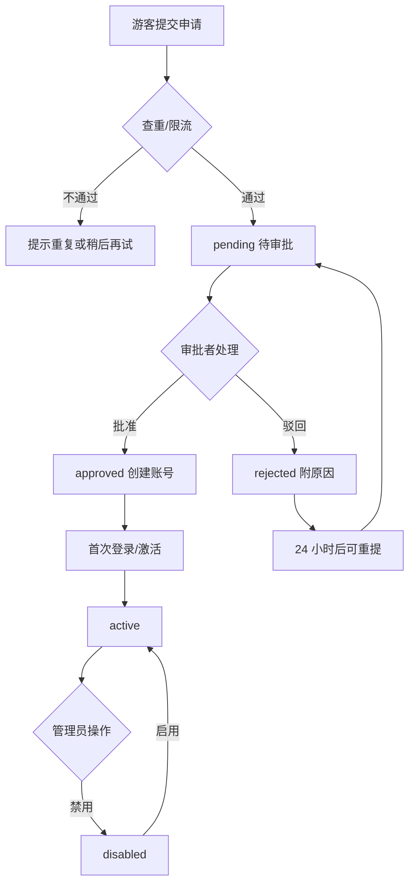

# 23 · 认证与账号申请规范

> 本文件补充 `05-architecture.md` 第 9 节“认证与权限”，把账号来源、申请审批、游客边界和导出权限固定为可实现的规则。
> API 路径、字段与错误码最终以 `05-architecture.md` 和 `contracts/openapi.json` 为准；本文件新增的端点均标注“补充”，实现前必须先同步 05 与 OpenAPI。
>
> 2026-11-10 实现状态：B05 已实现登录、me、申请/状态、退出、改密、申请列表/批准/驳回、用户列表/更新、审计列表；未实现限流、24h 重提冷却/最多 3 次、强制改密拦截、刷新令牌、微信登录、服务端吊销、批量建号。导出权限随 Step 4 收口。

## 1. 目标、范围与非目标

### 1.1 目标

1. 统一账号来源：后台批量导入、微信小程序申请、游客只读三条路径，不出现“私下建号”。
2. 固定角色与权限边界，避免“能看数据的人都能导出”“能进后台的人都能改角色”。
3. 固定申请状态机与审批动作，保证 Web 后台与小程序管理端行为一致。
4. 固定导出权限：游客不可导出；审核通过的用户按角色导出；导出格式不在页面预选。
5. 给出可执行的验收矩阵，覆盖游客、申请者、查看者、编辑者、管理员、审批者六类身份。

### 1.2 范围

- 本地账号：用户名、密码、显示名、单位、手机号、角色、状态。
- 后台批量导入：CSV/Excel 模板、初始密码或邀请码、激活、角色、单位、手机号、状态。
- 小程序账号申请：表单、校验、隐私告知、限流、重复检测、申请状态查询。
- 游客模式：未登录可浏览已发布数据；AI 受限；导出禁用。
- 审批流程：Web 后台与小程序管理端；小程序仅承担轻量审批，重操作留在 Web。
- 导出权限：PNG、PDF、XLSX、CSV 四种格式的权限判定。
- 审计：登录、申请、审批、角色与状态变更、导出。

### 1.3 非目标

- 不实现微信真实登录、手机号短信验证、粤政易 SSO；只保留接口位置与后续接入说明。
- 不做公众注册、开放 API、多租户、复杂组织架构、多级会签。
- 不做自助找回密码、短信通知、邮件通知；P1 再评估。
- 不做导出计费、定制水印、外部共享链接。
- 不改变 `05-architecture.md` 的数据模型与既有 API 语义；新增端点先改契约。

## 2. 角色与权限矩阵

### 2.1 角色定义

| 角色 | 定义 | 账号状态 | 说明 |
|---|---|---|---|
| `guest` | 未登录访问者 | 无账号 | 可浏览已发布数据；AI 受限；不可导出；可提交申请 |
| `applicant` | 已提交申请、尚未批准的人 | 无账号 | 只能提交/查看本人申请；不能访问数据页 |
| `viewer` | 已批准的公职人员 | `active` | 浏览已发布数据、使用 AI、按角色导出 |
| `editor` | 数据维护人员 | `active` | viewer 权限 + 编辑数据值 + Excel 导入；以 Web 为主 |
| `admin` | 系统管理员 | `active` | 用户、申请、角色、审计、导入、指标目录、组件库；小程序仅轻量管理 |
| `approver` | 审批者 | `active` | viewer 权限 + 审批申请；可与 `admin` 合并 |

说明：

1. `applicant` 是申请状态，不是账号角色；批准前不创建 `users` 记录。
2. `approver` 可以是独立角色，也可以是 `admin` 上的审批权限位；产品行为一致，实现方式在批次记录中固定。
3. `admin` 默认包含审批权限；`approver` 不包含用户角色配置、导入、指标目录、组件库等重操作。
4. 领导/决策者不是独立角色，使用 `viewer` 的统一页面并导出汇报卡；不设“领导模式”。

### 2.2 权限矩阵

| 能力 | `guest` | `applicant` | `viewer` | `editor` | `admin` | `approver` |
|---|---|---|---|---|---|---|
| 浏览已发布数据 | 允许 | 禁止 | 允许 | 允许 | 允许 | 允许 |
| AI 问答 | 受限（每日配额） | 禁止 | 允许 | 允许 | 允许 | 允许 |
| 导出 PNG/PDF/XLSX/CSV | 禁止 | 禁止 | 允许 | 允许 | 允许 | 允许 |
| 提交账号申请 | 允许（提交后转 applicant） | 仅驳回后重提 | 不适用 | 不适用 | 不适用 | 不适用 |
| 查看本人申请状态 | 允许（凭申请编号与状态令牌） | 允许 | 不适用 | 不适用 | 不适用 | 不适用 |
| 编辑数据值 | 禁止 | 禁止 | 禁止 | 允许（Web） | 允许 | 禁止 |
| Excel 导入/导入记录 | 禁止 | 禁止 | 禁止 | 允许（Web） | 允许 | 禁止 |
| 用户/角色管理 | 禁止 | 禁止 | 禁止 | 禁止 | 允许（Web） | 禁止 |
| 审批申请 | 禁止 | 禁止 | 禁止 | 禁止 | 允许 | 允许 |
| 查看审计 | 禁止 | 禁止 | 禁止 | 禁止 | 全部（Web） | 申请相关摘要 |
| 导出任务管理 | 禁止 | 禁止 | 禁止 | 禁止 | 允许（Web） | 禁止 |
| 指标/数据目录维护 | 禁止 | 禁止 | 禁止 | 禁止 | 允许（Web） | 禁止 |
| 组件库维护 | 禁止 | 禁止 | 禁止 | 禁止 | 允许（Web） | 禁止 |

### 2.3 端能力边界

| 端 | 允许 | 不允许 |
|---|---|---|
| 微信小程序 | 浏览、AI、导出、申请、申请状态；管理员审批、用户启停、审计摘要 | 导入、角色配置、指标目录、组件库、批量用户操作 |
| Web 后台 | 登录、总览、数据列表/编辑、导入、用户/角色、审批、审计、指标目录、组件库、导出任务 | 绕过服务端权限；在客户端保存密钥 |

小程序管理端只承担“待审批列表、申请详情、批准/驳回、用户启停、审计摘要”五类动作；角色调整、批量导入、组件库等重操作必须回 Web 后台。

### 2.4 权限判定规则

1. 所有权限在服务端判定，客户端隐藏按钮只作为体验优化，不作为安全边界。
2. 默认拒绝：路由未声明允许角色时返回 `FORBIDDEN`。
3. JWT 只携带 `sub`、`role`、`exp` 等最小声明；是否禁用、角色是否变化以服务端数据库为准。
4. 导出接口必须同时校验角色与资源范围；`guest`、`applicant` 一律返回 `EXPORT_FORBIDDEN`。
5. 审批接口必须校验“非本人申请”；管理员也不能审批自己的申请。
6. 组织/单位范围权限为 P1；11.12 先按全局角色控制，预留 `scope` 字段。

## 3. 用户来源

### 3.1 后台批量导入

| 字段 | 必填 | 规则 | 说明 |
|---|---|---|---|
| `username` | 是 | 4–32 位，字母/数字/下划线/点/短横线 | 唯一；不区分大小写查重 |
| `display_name` | 是 | 2–20 字 | 真实姓名或常用显示名 |
| `unit` | 是 | 2–50 字 | 单位/科室 |
| `phone` | 是 | 中国大陆手机号 `^1[3-9]\d{9}$` | 唯一；用于账号识别与审批核对 |
| `role` | 是 | `viewer`/`editor`/`admin`/`approver` | 不允许导入 `guest`/`applicant` |
| `initial_password` | 二选一 | 至少 10 位，含字母与数字 | 与 `invite_code` 二选一 |
| `invite_code` | 二选一 | 一次性，7 天有效 | 用于小程序激活绑定 |
| `status` | 否 | `active`/`disabled`，默认 `active` | 导入后仍受首次改密约束 |
| `remark` | 否 | ≤200 字 | 批次备注，不进入普通列表 |

规则：

1. 支持 CSV/Excel；单次 ≤1000 行；表头必须匹配；重复用户名/手机号整批拒绝并给行号。
2. 初始密码只在导入结果页展示一次，可下载一次性文件；不写日志、不入库明文、不通过聊天工具传递。
3. 首次登录强制修改密码；未改密前除 `/auth/me`、改密接口外不得访问业务接口。
4. 邀请码激活：小程序输入邀请码 + 手机号，绑定微信身份后设置密码；P1 实现，11.12 可用管理员代建账号替代。
5. 导入、改角色、禁用、重置密码均写审计；导入失败保留批次与错误行。

### 3.2 小程序账号申请

| 字段 | 必填 | 校验 | 说明 |
|---|---|---|---|
| `display_name` | 是 | 2–20 字 | 真实姓名 |
| `unit` | 是 | 2–50 字 | 单位/科室 |
| `phone` | 是 | 中国大陆手机号 | 唯一；用于查重与审批联系 |
| `reason` | 是 | 10–200 字 | 申请说明，便于审批判断 |
| `privacy_consent` | 是 | 必须勾选 | 不默认勾选；附隐私告知链接 |

隐私告知至少包含：收集字段、用途、保存期限、访问范围、联系人、不收集身份证号/住址/人脸等敏感信息。申请页只收集上述四项，不要求上传证件。

限流与查重：

| 规则 | 阈值 | 处理 |
|---|---|---|
| 同一手机号待审申请 | 最多 1 条 | 返回 `APPLICATION_DUPLICATE` 并展示状态 |
| 同一 IP 每日提交 | 最多 3 次 | 返回 `RATE_LIMITED` |
| 同一设备每日提交 | 最多 3 次 | 返回 `RATE_LIMITED` |
| 驳回后重提 | 24 小时后，最多 3 次 | 需修改申请说明；超过转人工 |
| 已存在 active 账号 | 拒绝新建 | 引导登录或联系管理员 |
| 已存在 disabled 账号 | 拒绝新建 | 提示联系管理员恢复 |

提交成功后返回 `application_no` 与 `status_token`；`status_token` 为随机不透明字符串，仅保存在本机，用于查询状态，避免按手机号枚举他人申请。

### 3.3 游客模式

1. 无账号、无 `users` 记录；可浏览 `published` 数据与区域/指标目录。
2. AI 每日配额基线：5 次/设备、20 次/IP；不保存会话历史，不提供追问上下文持久化。
3. 禁止导出、禁止编辑、禁止进入管理页；导出按钮置灰并提示“申请账号后按角色开放”。
4. 首页与“我的”提供申请入口；申请提交后转为 `applicant`，数据页被拦截，只显示申请状态。
5. 游客不采集姓名/手机号；设备标识只用于限流，不写入业务表。

### 3.4 账号来源优先级与合并

1. 后台导入优先：已导入的账号不因小程序申请重复创建。
2. 申请时按手机号查重：active 引导登录；pending 展示状态；rejected 允许冷却后重提；disabled 提示联系管理员。
3. 一个手机号只对应一个账号；P1 再做微信 `openid` 绑定与历史申请合并。
4. 11.12 不做自助“认领已导入账号”；由管理员在 Web 后台处理。

## 4. 申请状态机

### 4.1 状态定义

| 状态 | 所属对象 | 含义 | 可访问数据 |
|---|---|---|---|
| `none` | 申请 | 从未提交 | 游客可浏览；申请者无 |
| `pending` | 申请 | 已提交，待审批 | 否 |
| `approved` | 申请 | 已批准，账号已创建但未激活 | 否 |
| `rejected` | 申请 | 已驳回，附原因 | 否 |
| `active` | 账号 | 已激活，可登录 | 是（按角色） |
| `disabled` | 账号 | 已禁用 | 否 |

### 4.2 状态流转

| 从 | 事件 | 操作者 | 到 | 副作用 | 审计 |
|---|---|---|---|---|---|
| `none` | 提交申请 | 游客 | `pending` | 生成申请编号、状态令牌 | 记录手机号后四位、IP、时间 |
| `pending` | 批准 | `admin`/`approver` | `approved` | 创建用户、分配角色与单位 | 记录审批者、角色、备注 |
| `pending` | 驳回 | `admin`/`approver` | `rejected` | 保存驳回原因 | 记录审批者、原因 |
| `approved` | 首次登录/激活 | 申请者 | `active` | 强制改密或绑定微信 | 记录激活时间 |
| `active` | 禁用 | `admin` | `disabled` | 撤销会话、拒绝新登录 | 记录原因、操作者 |
| `disabled` | 启用 | `admin` | `active` | 恢复登录 | 记录原因、操作者 |
| `rejected` | 重新提交 | 申请者 | `pending` | 24 小时冷却、最多 3 次 | 记录新说明、次数 |
| `pending` | 撤回 | 申请者 | `none` | P1；11.12 不做 | 预留 |

并发与幂等：

1. 审批前校验申请仍为 `pending`；已处理返回 `APPLICATION_NOT_PENDING`。
2. 同一申请重复批准不重复建号；以申请编号做幂等键。
3. 批准时再次校验手机号是否已被占用；冲突则拒绝并提示管理员合并。

### 4.3 重提规则

1. 驳回后 24 小时内不可重提；页面显示可重提时间。
2. 最多 3 次；第 4 次提示联系管理员，不自动开放。
3. 重提必须修改申请说明；手机号、姓名、单位不可借重提绕过查重。
4. 管理员可对恶意申请标记“禁止重提”；标记写审计。

### 4.4 审计事件

`application.submit`、`application.approve`、`application.reject`、`application.resubmit`、`user.activate`、`user.disable`、`user.enable`、`user.role_change`、`user.password_reset`、`export.create`。每条包含操作者、目标、时间、IP、User-Agent、变更前后摘要；不记录明文密码与完整令牌。

## 5. 审批流程

### 5.1 总体流程



### 5.2 Web 后台审批

入口：AD08“用户/权限”中的“申请审批”页签。内容：

1. 待审批列表：申请编号、姓名、单位、手机号（默认掩码）、提交时间、状态、重提次数。
2. 筛选：状态、关键词、时间范围；分页。
3. 详情抽屉：完整申请信息、隐私告知版本、历史申请、审计摘要。
4. 批准：选择角色（默认 `viewer`）、确认单位；可填写备注；批准后创建账号。
5. 驳回：必须填写原因（5–200 字）；原因展示给申请者。
6. 批量批准仅 P1；11.12 只做单条，避免误批。

### 5.3 小程序管理端审批

入口：MP15，仅 `admin`/`approver` 可见。范围：

| 功能 | 小程序 | 说明 |
|---|---|---|
| 待审批列表 | 允许 | 姓名、单位、手机号掩码、提交时间、重提次数 |
| 申请详情 | 允许 | 完整姓名/单位/手机号；访问写审计 |
| 批准 | 允许 | 默认 `viewer`；`admin` 可选 `editor`/`approver`；仅 `admin` 可分配 `admin` |
| 驳回 | 允许 | 原因必填 5–200 字 |
| 用户启停 | 允许 | 只切换 `active`/`disabled`，不改角色 |
| 审计摘要 | 允许 | 最近 10 条申请相关事件，不可导出 |
| 角色配置/批量操作/导入/组件库 | 禁止 | 回 Web 后台 |

### 5.4 审批规则

1. 禁止自批：申请者手机号或关联用户 ID 与当前审批者一致时，前端隐藏按钮，后端返回 `CANNOT_APPROVE_SELF`。
2. 禁止越权分配：`approver` 只能批准为 `viewer`；`admin` 可分配 `viewer`/`editor`/`approver`/`admin`。
3. 最后一个 `admin` 不可禁用、不可降级；返回 `LAST_ADMIN_PROTECTED`。
4. 驳回必须给原因；批准可选备注；两者都写审计。
5. 审批结果不通过站内信/短信推送（11.12）；申请者主动查询状态。
6. 管理员账号由部署脚本或运维初始化，不通过公开申请产生。

## 6. 认证与 API 契约摘要

### 6.1 通用约定

- Base：`/api/v1`；JSON UTF-8；认证头 `Authorization: Bearer <JWT>`。
- 成功：`{ "data": ..., "meta": {...} }`；错误：`{ "error": { "code", "message", "details" }, "request_id" }`。
- 分页：`page`、`page_size`（默认 20，最大 100）；返回 `meta.total`。
- 时间 ISO 8601；手机号在列表默认掩码；日志不记录完整令牌与密码。

### 6.2 端点

| 方法 | 路径 | 认证/角色 | 用途 | 备注 |
|---|---|---|---|---|
| POST | `/auth/login` | 公开，限流 | 用户名/密码登录 | 返回 access token 与用户摘要 |
| GET | `/auth/me` | 已登录 | 当前用户、角色、单位、状态 | 禁用用户返回 `USER_DISABLED` |
| POST | `/auth/apply` | 公开，限流 | 提交账号申请 | 返回 `application_no`、`status_token` |
| GET | `/auth/application-status` | 公开，凭编号+令牌 | 查询本人申请状态 | 不接受仅手机号查询 |
| GET | `/admin/applications` | `admin`/`approver` | 申请列表/筛选 | 手机号掩码；详情单独审计 |
| POST | `/admin/applications/{id}/approve` | `admin`/`approver` | 批准并创建账号 | 禁止自批；幂等 |
| POST | `/admin/applications/{id}/reject` | `admin`/`approver` | 驳回并记录原因 | 原因必填 |
| GET | `/admin/users` | `admin` | 用户列表/筛选 | 手机号掩码 |
| PATCH | `/admin/users/{id}` | `admin` | 改角色/启停/重置密码 | 补充端点，先同步 05/OpenAPI |
| POST | `/auth/logout` | 已登录 | 退出登录 | 补充；P1 服务端吊销 |
| POST | `/auth/change-password` | 已登录 | 首次改密/主动改密 | 补充；改密后旧令牌失效 |
| POST | `/auth/wechat-login` | 公开 | 微信登录 | 后期；11.12 可 mock |

### 6.3 请求与响应示例

登录：

```json
POST /api/v1/auth/login
{"username": "viewer01", "password": "**********"}

{"data": {"access_token": "<jwt>", "token_type": "bearer", "expires_in": 28800,
          "user": {"id": 12, "display_name": "张三", "role": "viewer", "unit": "曲溪街道"}}}
```

提交申请：

```json
POST /api/v1/auth/apply
{"display_name": "李四", "unit": "玉湖镇", "phone": "13800000000",
 "reason": "需要查询本镇指标并导出汇报卡", "privacy_consent": true}

{"data": {"application_no": "AP20261110001", "status": "pending",
          "status_token": "<opaque>", "submitted_at": "2026-11-10T09:00:00+08:00"}}
```

批准：

```json
POST /api/v1/admin/applications/123/approve
{"role": "viewer", "unit": "玉湖镇", "note": "单位核对通过"}

{"data": {"application_id": 123, "status": "approved", "user_id": 45, "role": "viewer"}}
```

### 6.4 错误码

| code | HTTP | 说明 |
|---|---|---|
| `AUTH_REQUIRED` | 401 | 未携带令牌 |
| `AUTH_INVALID` | 401 | 令牌无效/过期 |
| `USER_DISABLED` | 403 | 账号已禁用 |
| `FORBIDDEN` | 403 | 角色或资源不允许 |
| `VALIDATION_ERROR` | 422 | 字段校验失败 |
| `RATE_LIMITED` | 429 | 触发限流 |
| `APPLICATION_DUPLICATE` | 409 | 手机号已有待审/已有账号 |
| `APPLICATION_NOT_PENDING` | 409 | 申请已被处理 |
| `CANNOT_APPROVE_SELF` | 403 | 审批本人申请 |
| `LAST_ADMIN_PROTECTED` | 409 | 最后一个管理员不可禁用/降级 |
| `EXPORT_FORBIDDEN` | 403 | 游客/申请者或无导出角色 |
| `NOT_FOUND` | 404 | 资源不存在；不泄露存在性 |
| `INTERNAL_ERROR` | 500 | 未分类错误；不返回堆栈 |

### 6.5 JWT 与会话

1. 算法 HS256；`sub=user_id`、`role`、`exp`；access token 8 小时，可配置。
2. 令牌不携带姓名、手机号、单位等个人信息；需要时由 `/auth/me` 获取。
3. 服务端每次请求校验用户状态；禁用、改密、角色变更通过 `token_version` 使旧令牌失效。
4. 刷新令牌 P1；11.12 过期后重新登录。
5. 退出登录客户端清除令牌；服务端吊销 P1。
6. 游客默认不签发 JWT；如需限流可签发 2 小时 `role=guest` 的短期令牌，但不创建用户。
7. 微信登录后期接入：`wx.login` → code → 服务端 `code2session` → `openid` → 绑定本地账号；AppSecret 只在服务端。
8. 11.12 允许测试号/模拟登录，但必须在界面标注“演示登录”，不得伪装为正式微信授权。

### 6.6 限流基线

| 场景 | 限制 | 维度 |
|---|---|---|
| 登录 | 5 次/分钟、10 次/小时 | IP + 账号 |
| 提交申请 | 3 次/日 | IP、设备 |
| 查询申请状态 | 30 次/分钟 | IP |
| 审批操作 | 120 次/小时 | 用户 |
| 游客 AI | 5 次/日、20 次/日 | 设备、IP |
| 导出 | 10 次/小时 | 用户 |
| 改密 | 5 次/小时 | 用户 |

## 7. 安全与隐私

| 项 | 要求 |
|---|---|
| 密码 | argon2id 优先，bcrypt 可接受；禁止明文/MD5/SHA1；首次登录强制改密；最小 10 位 |
| 令牌 |  HTTPS 传输；不入 URL；Web 用内存/sessionStorage，小程序用本地存储；过期即失效 |
| 密钥 | AppSecret、JWT Secret、LLM Key 只在服务端环境变量；客户端与文档不出现真实值 |
| 个人信息 | 只收集姓名、单位、手机号；不收集身份证号、住址、人脸、家庭成员 |
| 展示 | 列表手机号掩码；完整手机号仅审批详情可见并写审计；导出不含未授权个人信息 |
| 审计 | 登录、申请、审批、角色/状态变更、导出；审计不可由普通管理员删除 |
| 权限 | 服务端判定；默认拒绝；禁止自批；最后管理员保护；越权返回 403 且不泄露资源 |
| 游客 | 不可导出；AI 限流；不保存历史；不采集姓名/手机号 |
| 传输 | 生产 HTTPS；CORS 白名单；上传类型/大小校验；错误不返回堆栈 |
| 日志 | 密码、令牌、完整手机号、AppSecret 一律脱敏；保留 request_id |
| 保留 | 驳回申请与审计日志保留期待确认；默认建议 180 天，超期匿名化或删除 |
| 导出文件 | 临时文件 24 小时清理；下载需鉴权；文件名不含个人信息 |

## 8. 验收与测试矩阵

### 8.1 角色与流程

| ID | 角色 | 场景 | 预期 |
|---|---|---|---|
| AUTH-01 | 游客 | 打开首页浏览区情 | 可见已发布数据与“演示数据”标识 |
| AUTH-02 | 游客 | 连续使用 AI 超过配额 | 第 6 次提示配额用尽，可申请账号 |
| AUTH-03 | 游客 | 点击导出 | 按钮禁用或提示无权限，接口返回 `EXPORT_FORBIDDEN` |
| AUTH-04 | 游客 | 提交申请 | 生成申请编号与状态令牌，状态为 `pending` |
| AUTH-05 | 申请者 | 访问区域/指标页 | 被拦截，引导查看申请状态 |
| AUTH-06 | 申请者 | 查询申请状态 | 仅凭申请编号+状态令牌可查；仅手机号不可查 |
| AUTH-07 | 申请者 | 驳回后立即重提 | 提示 24 小时冷却 |
| AUTH-08 | 查看者 | 浏览、AI、导出 | 均允许；导出格式需手动选择 |
| AUTH-09 | 编辑者 | 修改数据值、导入 | Web 允许；小程序不提供入口 |
| AUTH-10 | 管理员 | 用户列表、改角色、禁用 | 允许；操作写审计 |
| AUTH-11 | 管理员 | 禁用最后一个管理员 | 返回 `LAST_ADMIN_PROTECTED` |
| AUTH-12 | 审批者 | 批准申请 | 创建 `viewer` 账号；不可分配 `admin` |
| AUTH-13 | 审批者 | 驳回申请不填原因 | 校验失败，不改变状态 |
| AUTH-14 | 审批者 | 审批本人申请 | 前端隐藏按钮，后端返回 `CANNOT_APPROVE_SELF` |
| AUTH-15 | 管理员 | 小程序审批通过 | 账号 `active`，Web 列表同步可见 |
| AUTH-16 | 禁用用户 | 使用旧令牌访问 | 返回 `USER_DISABLED`，令牌失效 |

### 8.2 导出权限

| ID | 角色 | 场景 | 预期 |
|---|---|---|---|
| EXP-01 | 游客 | 任意页面导出 | 禁止；不生成文件 |
| EXP-02 | 申请者 | 任意页面导出 | 禁止；不生成文件 |
| EXP-03 | 查看者 | 选择 PNG/PDF/XLSX/CSV | 允许；必须手动选择格式，无默认 |
| EXP-04 | 编辑者/管理员/审批者 | 导出 | 允许；按同一格式选择流程 |
| EXP-05 | 任意已授权用户 | 导出含空值/不适用数据 | 文件保留“暂无数据/不适用”标记，不写 0 |
| EXP-06 | 任意已授权用户 | 导出预览 | 含数据来源、数据时点、生成时间、演示水印 |
| EXP-07 | 任意用户 | 高频导出 | 超过 10 次/小时返回 `RATE_LIMITED` |

### 8.3 移动审批

| ID | 场景 | 预期 |
|---|---|---|
| MOB-01 | 管理员打开 MP15 | 可见待审批、用户状态、审计摘要 |
| MOB-02 | 非管理员打开 MP15 | 无入口；直接访问返回 `FORBIDDEN` |
| MOB-03 | 批准申请并选择 `viewer` | 成功；申请状态与用户状态同步 |
| MOB-04 | 驳回申请 | 原因必填；申请者可查看原因 |
| MOB-05 | 审批已处理申请 | 返回 `APPLICATION_NOT_PENDING`，不重复建号 |
| MOB-06 | 禁用已激活用户 | 成功；用户旧令牌失效 |
| MOB-07 | 尝试改角色/导入 | 小程序无入口；接口拒绝 |

### 8.4 安全

| ID | 场景 | 预期 |
|---|---|---|
| SEC-01 | 密码存储 | 数据库无明文；使用强哈希 |
| SEC-02 | 令牌过期 | 401，前端跳登录 |
| SEC-03 | 前端打包产物 | 无 JWT Secret、AppSecret、LLM Key |
| SEC-04 | 申请列表 | 手机号掩码；完整号码访问写审计 |
| SEC-05 | 审批接口越权 | `approver` 不能分配 `admin` |
| SEC-06 | 申请状态枚举 | 仅手机号无法查询他人申请 |
| SEC-07 | 登录失败提示 | 不区分“账号不存在/密码错误” |
| SEC-08 | 审计 | 登录、审批、角色变更、导出均有记录 |

## 9. 待确认问题

| ID | 问题 | 影响 | 11.12 处理 |
|---|---|---|---|
| AQ-01 | 微信真实登录/AppID 与粤政易 SSO 时间 | 登录方式与合规 | 先用测试号/模拟登录；接口预留 |
| AQ-02 | 是否引入短信验证码/手机号实名核验 | 申请质量与成本 | 11.12 不做短信；管理员人工核对 |
| AQ-03 | `approver` 最终是独立角色还是权限位 | 数据模型与前端 | 产品行为按本文件；实现方式批次记录 |
| AQ-04 | 导入初始密码的发放渠道 | 安全与运维 | 一次性下载；不通过聊天工具 |
| AQ-05 | 驳回申请、审计日志的保留期限 | 隐私与存储 | 暂按 180 天，需求方确认 |
| AQ-06 | 导出水印文案与文件保留 | 合规与体验 | 统一“演示数据/来源/时间”；24 小时清理 |
| AQ-07 | 游客 AI 是否对公网开放及配额 | 成本与内容安全 | 11.12 演示环境开放，限流 |
| AQ-08 | 是否需要单位/科室数据范围权限 | 权限复杂度 | P1；11.12 全局角色 |

> 未确认项不阻塞 11.12 的“游客浏览 + 申请审批 + 角色导出”闭环；涉及真实微信、短信、粤政易的能力在后续批次接入。
