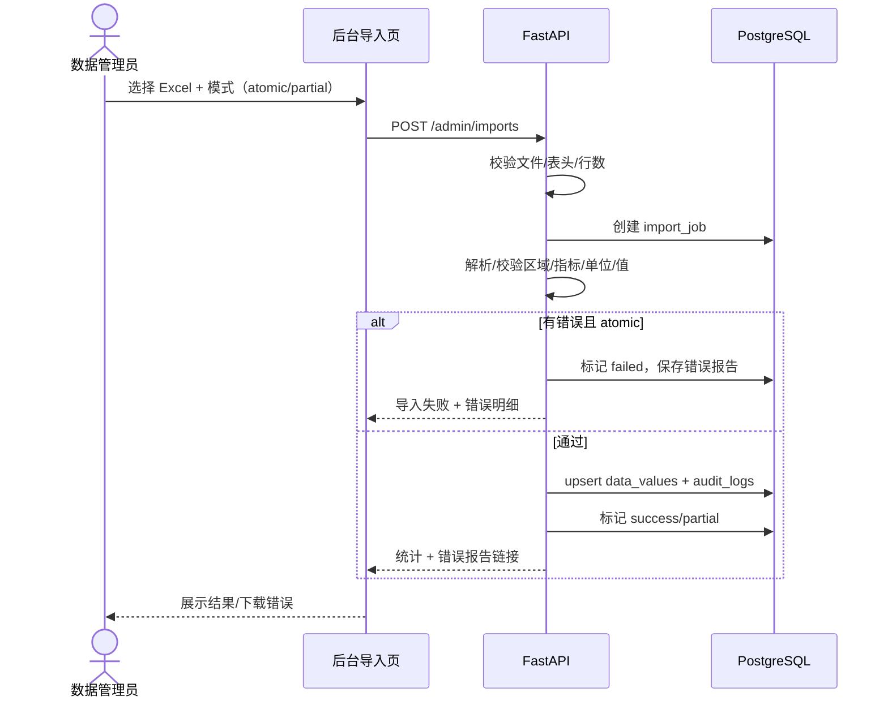
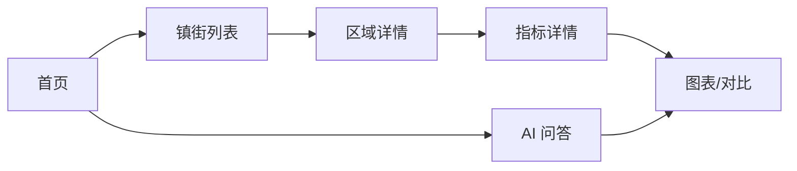
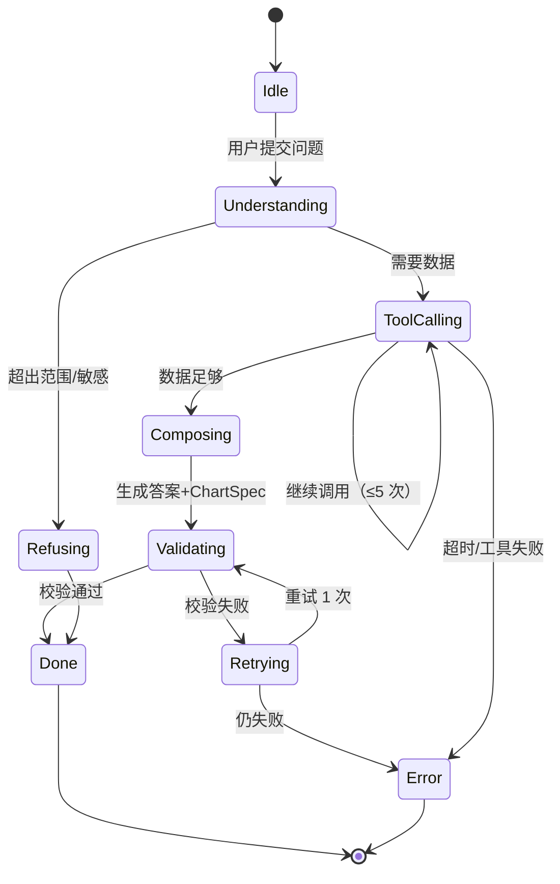

# 02 · 信息架构与核心流程

## 1. 信息架构

### 1.1 移动端（原生微信小程序）

```text
首页
├── 揭东区总览（核心指标卡片）
├── 镇街入口（列表/搜索）
├── 快捷提问（AI）
└── 最近浏览
区域
├── 区域列表（区/镇街/村居，按层级）
├── 区域详情（简介/特色/关键指标）
└── 指标详情（值/单位/年份/对比/图表）
问答
├── 会话列表
├── 会话详情（消息/图表/引用）
└── 追问
我的
├── 登录/身份（如需）
├── 收藏/最近（P1）
└── 关于/帮助
```

### 1.2 Web 后台

```text
登录
├── 总览（数据覆盖率/最近导入/问答量）
├── 数据管理
│   ├── 数据值列表（区域/指标/年份筛选）
│   ├── 编辑数据值
│   └── 区域/指标管理（P1）
├── 导入
│   ├── 上传 Excel
│   ├── 导入记录
│   └── 错误报告
├── 问答记录（P1）
├── 审计日志
└── 用户/权限（P1）
```

## 2. 页面清单

| ID | 端 | 页面 | 优先级 | 说明 |
|---|---|---|---|---|
| P-M01 | 移动 | 首页 | P0 | 核心指标 + 镇街入口 + AI 入口 |
| P-M02 | 移动 | 区域列表 | P0 | 层级切换/搜索 |
| P-M03 | 移动 | 区域详情 | P0 | 简介/特色/指标卡片 |
| P-M04 | 移动 | 指标详情 | P0 | 值/单位/年份/来源/图表/对比 |
| P-M05 | 移动 | AI 问答 | P0 | 输入/答案/图表/引用/追问 |
| P-M06 | 移动 | 会话列表 | P1 | 历史会话 |
| P-M07 | 移动 | 我的/帮助 | P1 | 登录/关于/反馈 |
| P-A01 | 后台 | 登录 | P0 | 用户名/密码 |
| P-A02 | 后台 | 总览 | P0 | 覆盖率/最近导入/问答量 |
| P-A03 | 后台 | 数据列表 | P0 | 筛选/分页/编辑入口 |
| P-A04 | 后台 | 数据编辑 | P0 | 表单/校验/审计提示 |
| P-A05 | 后台 | 导入 | P0 | 上传/进度/结果/错误 |
| P-A06 | 后台 | 导入记录 | P0 | 列表/详情/错误下载 |
| P-A07 | 后台 | 审计日志 | P0 | 筛选 |
| P-A08 | 后台 | 用户/权限 | P1 | 角色管理 |
| P-A09 | 后台 | 问答记录 | P1 | 问题/答案/工具/反馈 |

## 3. 核心流程

### 3.1 数据导入（后台）



**状态**：`pending → running → success | partial | failed`。
**关键规则**：空值警告不算失败；重复导入按唯一键更新；错误必须定位到行/列。

### 3.2 浏览数据（移动端）



**状态**：

- 首页：loading / 有数据 / 空数据 / 错误。
- 区域列表：加载中 / 列表 / 空 / 搜索无结果 / 错误。
- 区域详情：加载中 / 有指标 / 无适用指标 / 错误。
- 指标详情：有值 / 无数据 / 图表渲染失败（降级表格）/ 错误。

### 3.3 AI 问答



**前端状态**：`idle → submitting → thinking → tool_calling（可显示“正在查询数据”）→ composing → done / error / refused`。

**答案结构**：

1. 一句结论。
2. 数据表/图表。
3. 引用（指标/区域/年份）。
4. 追问建议。
5. 错误/拒答说明（如适用）。

## 4. 导航与可见性

- 移动端底部导航：首页 / 区域 / 问答 / 我的（P0 可先 3 个）。
- 后台左侧导航：总览 / 数据 / 导入 / 审计 / 设置（P1 用户）。
- 数据可见性：
  - 游客：只看公开/已发布数据（如启用）。
  - viewer：已发布数据 + AI。
  - editor：+ 编辑/导入。
  - admin：+ 用户/指标/区域/审计。

## 5. 空/错/loading 规范

| 场景 | 表现 |
|---|---|
| 页面加载 | 骨架屏/loading，不白屏 |
| 无数据 | 说明“当前没有该指标/年份数据”，给返回/切换入口 |
| 搜索无结果 | 显示关键词 + 清空/建议 |
| 网络错误 | 可重试；保留已输入内容 |
| AI 超时 | 显示“查询超时”，可重试；不丢问题 |
| AI 无数据 | 明确拒答/说明缺什么数据 |
| 图表失败 | 降级为表格；提供重试 |

## 6. 页面规范

详细字段/交互/验收见 [03-page-specs.md](03-page-specs.md)。当前只定义页面清单与状态；等需求方确认用户对象后补全。
