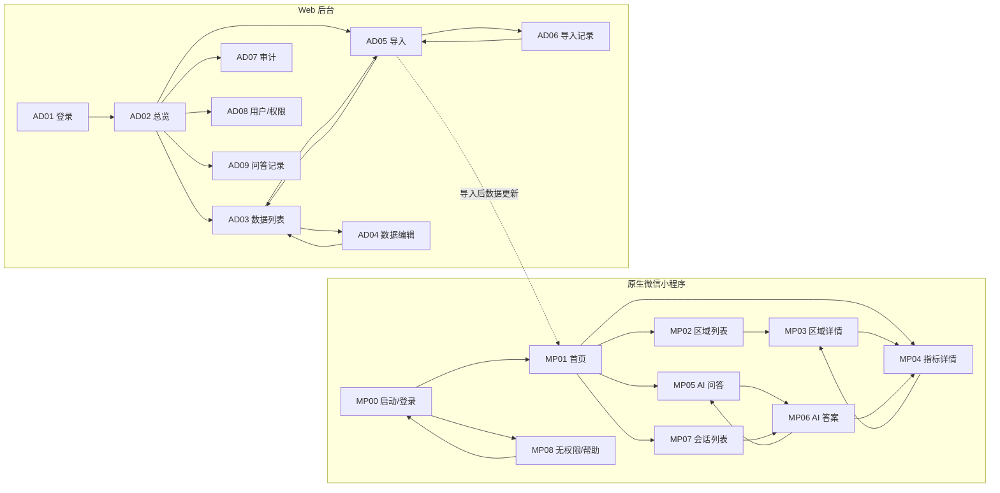

# 05 · 页面结构与交互地图

> 2026-11-10：页面设计 v2（含申请/审批/导出/移动管理）见 [06-page-design-v2.md](06-page-design-v2.md)；本文件保留结构地图与跳转。
>
> **状态：v1 已过时**。本文件为 18 页；06 已扩到 29 页（MP01–MP16、AD01–AD13，含 MP16 登录）。页面地图 v2 待 `UI-001`；v2 完成前以 06 为页面事实源。
>
> 本文件是**页面地图的文字版**；可缩放、可点击的 HTML 地图在 [`ue/page-map.html`](ue/page-map.html)。
> 低保真线框，不含品牌色/视觉风格；只表达页面结构、数据、交互与跳转。状态：初稿，待评审。

## 1. 页面清单

### 1.1 原生微信小程序

| ID | 页面 | 优先级 | 目的 | 关键数据 |
|---|---|---|---|---|
| MP00 | 启动/登录 | P0 | 进入应用；微信授权/测试号 | user、token |
| MP01 | 首页 | P0 | 看揭东区核心指标、镇街入口、AI 入口 | overview、regions |
| MP02 | 区域列表 | P0 | 按区/镇街/村居浏览、搜索 | regions |
| MP03 | 区域详情 | P0 | 看简介/特色/适用指标 | region、data_values |
| MP04 | 指标详情 | P0 | 看值/单位/年份/来源/图表 | indicator、data_values |
| MP05 | AI 问答（空） | P0 | 输入问题、示例引导 | session |
| MP06 | AI 问答（答案） | P0 | 答案+图表+引用+追问 | answer、chart_spec、citations |
| MP07 | 会话列表 | P1 | 查看历史问答 | sessions |
| MP08 | 无权限/帮助 | P0 | 粤政易友好页/帮助/联系 | app intro |

### 1.2 Web 后台

| ID | 页面 | 优先级 | 目的 | 关键数据 |
|---|---|---|---|---|
| AD01 | 登录 | P0 | 管理员进入后台 | user、token |
| AD02 | 总览 | P0 | 覆盖率、最近导入、问答量 | stats、import_jobs |
| AD03 | 数据列表 | P0 | 筛选/查看数据值 | data_values |
| AD04 | 数据编辑 | P0 | 单条修订（抽屉） | data_value、audit |
| AD05 | 导入 | P0 | 上传 Excel/校验/结果 | import_job、errors |
| AD06 | 导入记录 | P0 | 历史导入、错误报告 | import_jobs |
| AD07 | 审计日志 | P0 | 追查谁改了什么 | audit_logs |
| AD08 | 用户/权限 | P1 | 角色管理 | users |
| AD09 | 问答记录 | P1 | 看问题/答案/反馈 | chat_messages |

## 2. 导航总览

## 3. 跳转与数据传递

| 从 | 触发 | 到 | 携带数据 | 写入/副作用 |
|---|---|---|---|---|
| MP00 | 微信登录/测试号 | MP01 | user、token | 登录日志 |
| MP00 | 无权限/帮助 | MP08 | 无 | 无 |
| MP01 | 点镇街/区域 | MP02 | `level=town` | 无 |
| MP01 | 点指标卡 | MP04 | `region_id`、`indicator_id`、`period=2025` | 无 |
| MP01 | 点 AI 输入 | MP05 | 可选 `prompt` | 无 |
| MP01 | 点历史 | MP07 | 无 | 无 |
| MP02 | 选区域 | MP03 | `region_id` | 无 |
| MP03 | 点指标 | MP04 | `region_id`、`indicator_id` | 无 |
| MP04 | 返回 | MP03 | `region_id` | 无 |
| MP05 | 提交问题 | MP06 | `question`、`session_id` | `chat_sessions`/`chat_messages`/`audit_logs` |
| MP06 | 追问 | MP05 | `session_id`、上下文 | 同上 |
| MP06 | 点引用指标 | MP04 | `region_id`、`indicator_id`、`period` | 无 |
| MP07 | 打开会话 | MP06 | `session_id` | 无 |
| MP08 | 返回 | MP00 | 无 | 无 |
| AD01 | 登录 | AD02 | user、token | 登录日志 |
| AD02 | 导航数据 | AD03 | 无 | 无 |
| AD02 | 导航导入 | AD05 | 无 | 无 |
| AD02 | 导航审计 | AD07 | 无 | 无 |
| AD02 | 导航用户 | AD08 | 无 | 无 |
| AD02 | 导航问答 | AD09 | 无 | 无 |
| AD03 | 编辑行 | AD04 | `data_value_id` | 无 |
| AD04 | 保存 | AD03 | 修改后的值 | `data_values`、`audit_logs` |
| AD04 | 取消 | AD03 | 无 | 无 |
| AD03 | 去导入 | AD05 | 可选筛选条件 | 无 |
| AD05 | 上传/校验 | AD05（同页状态） | file、mode | `import_jobs`、`data_values` |
| AD05 | 查看记录 | AD06 | 无 | 无 |
| AD06 | 查看错误/重试 | AD05 | `import_job_id` | 无 |
| AD05 | 导入成功 | AD03 | 刷新筛选 | 数据更新 |
| AD05 | 导入成功 | MP01 | 数据版本变化 | 小程序读取最新 `data_values` |

> “MP05 → MP06”是同页状态切换：提交后先显示 thinking/tool_calling，再显示答案；不新建业务页面，但为可读性拆成两个设计状态。

## 4. 页面详情

### MP00 启动/登录

- **布局**：品牌占位区 + 标题 + 说明 + 登录按钮 + 帮助入口；垂直居中。
- **入口**：小程序启动/粤政易工作台（后期）。
- **交互**：点“微信登录/测试号” → MP01；点“无权限/帮助” → MP08。
- **状态**：未登录 / 登录中 / 登录失败 / 无权限。
- **数据**：`user`、`token`；不收集无关个人信息。
- **接口**：`POST /auth/wechat-login`（后期）或测试号模拟。

### MP01 首页

- **布局**：顶部标题/年份 + 4 个核心指标卡（2×2）+ 镇街入口列表 + AI 提问框 + 底部导航。
- **入口**：登录成功/底部“首页”。
- **交互**：点指标卡 → MP04；点镇街 → MP02；点 AI 输入 → MP05；点历史 → MP07。
- **状态**：loading 骨架 / 有数据 / 无数据 / 错误。
- **数据**：`overview`（区级指标）、`regions(level=town)`。
- **接口**：`GET /dashboard/overview`、`GET /regions?level=town`。

### MP02 区域列表

- **布局**：顶部返回/标题 + 层级 tabs（区/镇街/村居）+ 搜索 + 列表。
- **入口**：首页“镇街”/区域 tab。
- **交互**：切 tab 刷新列表；搜索；点行 → MP03（携带 `region_id`）。
- **状态**：loading / 列表 / 搜索无结果 / 空 / 错误。
- **数据**：`regions`（id/name/level/parent_id）；经开区/生态城无村居时不展示村居入口。
- **接口**：`GET /regions?level=&parent_id=&q=`。

### MP03 区域详情

- **布局**：顶部返回/区域名 + 文本简介/特色 + 指标卡列表 + 底部导航。
- **入口**：区域列表/首页。
- **交互**：点指标 → MP04（携带 `region_id` + `indicator_id`）；返回 → MP02。
- **状态**：loading / 有指标 / 无适用指标 / 错误。
- **数据**：`region`、`region_intro`、`region_feature`、`data_values`。
- **接口**：`GET /regions/{id}/profile`、`GET /data-values?region_id=&period=2025`。

### MP04 指标详情

- **布局**：顶部返回/指标名 + 值卡片（值/单位/年份/来源）+ 图表区 + 表格 + 对比按钮。
- **入口**：区域详情/首页指标卡/AI 引用。
- **交互**：切换年份（如有）；图表/表格切换；对比（P1）；返回 → 来源页。
- **状态**：有值 / 无数据 / 图表失败降级表格 / loading / 错误。
- **数据**：`indicator`、`data_values`、`source`。
- **接口**：`GET /data-values?region_id=&indicator_id=&period=`、`GET /data-values/compare`（P1）。

### MP05 AI 问答（空）

- **布局**：顶部标题 + 空状态（说明 + 示例问题 chips）+ 底部输入框。
- **入口**：首页 AI 入口/底部“问答”。
- **交互**：点示例填入；输入问题 → 提交 → MP06（同页状态）。
- **状态**：idle / submitting / thinking / error。
- **数据**：`question`、`session_id`（可选）。
- **接口**：`POST /ai/chat`。

### MP06 AI 问答（答案）

- **布局**：消息流（用户气泡/助手气泡）+ 答案文本 + 图表卡片 + 引用卡片 + 追问 chips + 输入框。
- **入口**：MP05 提交后/会话列表。
- **交互**：点引用 → MP04；点追问 → 继续提交；返回 → MP05 或会话。
- **状态**：tool_calling / composing / done / refused / error / timeout。
- **数据**：`answer_markdown`、`chart_spec`、`citations`、`follow_up_questions`。
- **接口**：`POST /ai/chat`、`GET /ai/sessions/{id}/messages`。

### MP07 会话列表（P1）

- **布局**：顶部“会话”+ 新建按钮 + 列表（标题/时间/摘要）。
- **入口**：首页“历史”/底部“问答”。
- **交互**：点会话 → MP06（`session_id`）；新建 → MP05。
- **状态**：loading / 列表 / 空 / 错误。
- **接口**：`GET /ai/sessions`。

### MP08 无权限/帮助

- **布局**：状态图标占位 + 标题 + 说明 + 申请/联系入口 + 应用简介/使用指南/维护电话。
- **入口**：无权限跳转/“我的”帮助。
- **交互**：返回/联系管理员/查看指南。
- **状态**：无权限 / 维护中 / 正常帮助。
- **数据**：应用简介、联系方式（配置）。
- **备注**：粤政易要求无权限友好页、应用简介、使用指南、维护提醒、联系电话。

### AD01 登录

- **布局**：居中登录卡（用户名/密码/登录按钮/错误提示）。
- **入口**：后台地址。
- **交互**：提交 → AD02；失败显示错误。
- **状态**：idle / submitting / error。
- **接口**：`POST /auth/login`、`GET /auth/me`。

### AD02 总览

- **布局**：顶栏 + 左侧导航 + 4 个统计卡 + 覆盖率表 + 最近导入 + 问答量。
- **入口**：登录成功/导航“总览”。
- **交互**：点统计卡/最近导入 → 对应页面。
- **状态**：loading / 有数据 / 空 / 错误。
- **接口**：`GET /dashboard/overview`、`GET /admin/imports`。

### AD03 数据列表

- **布局**：顶栏 + 侧栏 + 筛选行（区域/指标/年份/状态）+ 表格 + 分页。
- **入口**：总览/导航“数据”。
- **交互**：筛选；分页；点“编辑” → AD04（`data_value_id`）；点“导入” → AD05。
- **状态**：loading / 列表 / 空 / 错误。
- **接口**：`GET /admin/data-values`。

### AD04 数据编辑（抽屉）

- **布局**：AD03 列表 + 右侧抽屉（区域/指标/年份只读 + 值输入 + 单位提示 + 保存/取消）。
- **入口**：AD03 点“编辑”。
- **交互**：保存 → AD03（刷新 + 审计）；取消 → AD03；校验失败留在抽屉。
- **状态**：编辑中 / 保存中 / 校验错误 / 保存失败。
- **数据**：`data_value`；写入 `data_values` + `audit_logs`。
- **接口**：`PATCH /admin/data-values/{id}`。

### AD05 导入

- **布局**：上传区（拖拽/选择）+ 模板下载 + 模式（atomic/partial）+ 开始导入 + 结果统计 + 错误表。
- **入口**：总览/数据列表/导航“导入”。
- **交互**：上传 → 校验 → 结果；失败显示错误行；成功 → 刷新数据/可查看记录。
- **状态**：idle / uploading / validating / success / partial / failed。
- **数据**：file、mode、`import_job`、errors。
- **接口**：`POST /admin/imports`、`GET /admin/imports/{id}`、`GET /admin/imports/{id}/errors`。

### AD06 导入记录

- **布局**：筛选/列表（文件名/时间/操作者/状态/成功/失败）+ 错误下载。
- **入口**：AD05/总览。
- **交互**：查看错误；重试/回到导入。
- **状态**：loading / 列表 / 空 / 错误。
- **接口**：`GET /admin/imports`、`GET /admin/imports/{id}/errors`。

### AD07 审计日志

- **布局**：筛选（用户/动作/资源/时间）+ 表格（时间/用户/动作/资源/详情）。
- **入口**：总览/导航“审计”。
- **交互**：筛选；查看详情；分页。
- **状态**：loading / 列表 / 空 / 错误。
- **接口**：`GET /admin/audit-logs`。

### AD08 用户/权限（P1）

- **布局**：用户表（用户名/显示名/角色/状态/最后登录）+ 新增/编辑。
- **入口**：总览/导航“用户”。
- **交互**：改角色/禁用；不能删除最后一个 admin。
- **接口**：`GET /admin/users`、`PATCH /admin/users/{id}`（P1）。

### AD09 问答记录（P1）

- **布局**：问答表（问题/答案摘要/工具/耗时/反馈）+ 详情。
- **入口**：总览/导航“问答”。
- **交互**：查看详情；标记问题（P1）。
- **接口**：`GET /admin/chat-logs`（P1）。

## 5. 数据对象

| 对象 | 字段（最小） | 产生/写入 | 读取页面 |
|---|---|---|---|
| `regions` | id、code、name、level、parent_id | 种子/管理 | MP01/02/03、AD03 |
| `indicators` | id、code、name、unit、value_type、applicable_levels | 种子/管理 | MP03/04、AD03 |
| `data_values` | region_id、indicator_id、period_year、value_number/value_text、source_id | 导入/手工/接口 | MP03/04、AD03/04 |
| `import_jobs` | job_type、filename、status、stats、errors | 导入/同步 | AD05/06 |
| `chat_sessions`/`chat_messages` | session_id、role、content、chart_spec、citations | AI 问答 | MP05/06/07、AD09 |
| `audit_logs` | user_id、action、resource、detail | 写操作/登录/AI | AD07 |

## 6. 状态与异常

| 页面 | 空 | 错误 | 特殊 |
|---|---|---|---|
| MP01 | “数据准备中” | 重试 | 无数据不白屏 |
| MP02 | 无匹配区域 | 重试 | 经开区/生态城无村居 |
| MP03 | 无适用指标 | 重试 | 文本超长截断提示 |
| MP04 | 无该指标/年份 | 图表降级表格 | 空值不画 0 |
| MP05/06 | 示例引导 | 超时/额度/无效输出 | 拒答/无数据 |
| AD03/04 | 无筛选结果 | 保存失败留抽屉 | 审计提示 |
| AD05/06 | 无导入记录 | 校验失败显示行 | atomic/partial |
| AD07/08/09 | 无记录 | 重试 | 权限控制 |

## 7. 不做什么

- 不做视觉风格/品牌色/高保真 UI；本文件与 HTML 地图只表达结构。
- 不做地图/大屏/导出/多年趋势（P1/P2）。
- 不把 AI 生成的图表 option 直接渲染；只渲染 ChartSpec。
- 不把未验证的接口/字段写成事实；待确认项见 `12-open-questions.md`。

## 8. 打开方式

- HTML 地图：[`ue/page-map.html`](ue/page-map.html)（离线打开；可缩放/搜索/点击页面看详情/导出 PNG）。
- 线框总览：[`ue/wireframes.html`](ue/wireframes.html)（18 页灰度线框，可跳到地图详情）。
- 生成说明：[`ue/README.md`](ue/README.md)。
- 线框源文件：`ue/screens/*.html`；截图：`ue/screens/*.png`。
