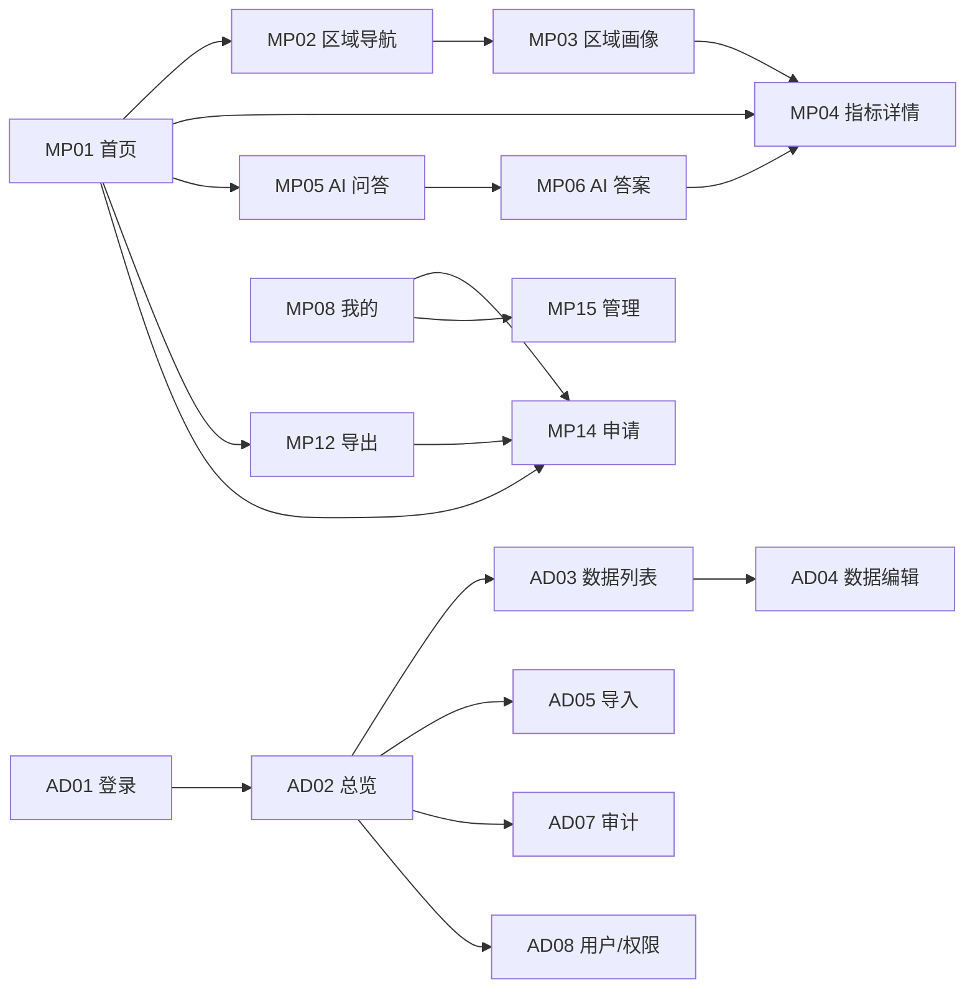

# 06 · 页面设计 v2

> 本文件是页面设计 v2，承接 `05-page-structure.md` 的结构地图，补齐认证/申请/导出/管理端页面与数据呈现规则。
> 页面 ID 固定为 MP01–MP15、AD01–AD13；11.12 只实现标注为 P0 的子集。
> 视觉为**中性政务基线**，不锁定品牌色；正式风格在 UE 阶段由多个方向比选后确定。

## 1. 目标与原则

| 原则 | 说明 | 验收指向 |
|---|---|---|
| 数据优先 | 首屏先给结论与关键数字，装饰让位于可读性 | 首页 3 秒内看到核心指标 |
| 三次点击 | 首页 → 区域/指标 → 图表 ≤3 次点击 | 可用性走查 |
| 不设领导模式 | 领导使用统一首页、指标、排名、导出汇报卡 | 无独立入口/独立页面 |
| 游客可看、不可导 | 未登录可浏览已发布数据；导出按角色开放 | 导出权限矩阵 |
| 申请即状态 | 无账号先申请；待审只能看状态，不能看数据 | 申请状态机 |
| 移动轻管理 | 管理员可在小程序审批与启停用户；重操作回 Web | MP15 范围 |
| 格式不预选 | 导出必须手动选择 PNG/PDF/XLSX/CSV | 导出界面 |
| 演示可识别 | 合成数据必须标注“演示数据”与数据时点 | 全局水印 |
| 视觉后置 | 11.12 用中性政务基线，不锁定品牌 | 视觉基线 |

11.12 的交付形态是**可运行 Demo v0**：一台小服务器 + 原生微信小程序 + 可真实操作的 Web 后台。Web 后台必须“可视化”，即页面可打开、可点击、可看到数据与状态，不以截图或静态稿代替。

## 2. 信息架构 v2

### 2.1 全局导航

小程序底部导航：首页 / 区域 / 问答 / 我的。管理员在“我的”内看到“管理”入口，不新增第五个 tab。

Web 后台左侧导航：总览 / 数据 / 导入 / 用户与审批 / 审计 / 设置。设置组内含指标目录、数据质量、组件库、导出任务，P1 逐项开放。

### 2.2 小程序页面清单

| ID | 页面 | 优先级 | 目的 | 11.12 |
|---|---|---|---|---|
| MP01 | 首页/区情总览 | P0 | 核心指标、镇街入口、AI 入口、数据时点 | 是 |
| MP02 | 区域导航 | P0 | 区/镇街/村居浏览与搜索 | 是 |
| MP03 | 区域画像 | P0 | 简介、特色、适用指标 | 是 |
| MP04 | 指标详情 | P0 | 值/单位/年份/来源/图表/导出入口 | 是 |
| MP05 | AI 问答（空/会话） | P0 | 示例问题、输入、会话状态 | 是 |
| MP06 | AI 答案 | P0 | 结论、图表、引用、追问 | 是 |
| MP07 | 会话历史 | P1 | 历史会话列表 | 否 |
| MP08 | 我的/帮助 | P0 | 身份、申请状态、帮助、管理入口 | 是 |
| MP09 | 对比分析 | P1 | 多区域同指标对比 | 否 |
| MP10 | 排名榜单 | P1 | 镇街/村居排名 | 否 |
| MP11 | 关系分析 | P1 | 指标间关系与解释 | 否 |
| MP12 | 导出预览/汇报卡 | P0 | 格式选择、预览、水印、生成 | 是 |
| MP13 | 数据快查 | P1 | 关键词/指标直达 | 否 |
| MP14 | 申请账号/申请状态 | P0 | 提交申请、查看进度、重提 | 是 |
| MP15 | 管理（审批/用户状态/审计摘要） | P0 | 管理员移动轻管理 | 是 |

### 2.3 Web 后台页面清单

| ID | 页面 | 优先级 | 目的 | 11.12 |
|---|---|---|---|---|
| AD01 | 登录 | P0 | 管理员进入后台 | 是 |
| AD02 | 总览 | P0 | 数据覆盖、待审申请、最近导入、问答量 | 是 |
| AD03 | 数据列表 | P0 | 筛选、查看、进入编辑/导出 | 是 |
| AD04 | 数据编辑 | P0 | 单条修订（抽屉） | 是 |
| AD05 | 导入 | P0 | 上传 Excel、校验、结果 | 是 |
| AD06 | 导入记录 | P0 | 历史批次、错误报告 | 是 |
| AD07 | 审计 | P0 | 追溯登录、审批、改数、导出 | 是 |
| AD08 | 用户/权限 | P0 | 用户、申请审批、角色、状态 | 是 |
| AD09 | 问答记录 | P1 | 问题、答案、工具、反馈 | 否 |
| AD10 | 指标/数据目录 | P1 | 指标元数据、适用层级、口径 | 否 |
| AD11 | 数据质量/覆盖率 | P1 | 区域×指标×年份覆盖与异常 | 否 |
| AD12 | 组件库 | P1 | 图表/卡片/状态组件管理 | 否 |
| AD13 | 导出任务 | P1 | 导出记录、文件清理、失败重试 | 否 |

### 2.4 11.12 P0 子集

- 小程序：MP01、MP02、MP03、MP04、MP05/06、MP08、MP12、MP14、MP15。
- Web 后台：AD01、AD02、AD03、AD04、AD05、AD06、AD07、AD08。
- 页面关系：MP01 → MP02/MP03/MP05/MP12/MP14；MP03 → MP04；MP04 → MP12；MP05 → MP06；MP08/MP14 → MP15（仅管理员）；AD02 → AD03/AD05/AD07/AD08；AD03 → AD04/AD05。

### 2.5 页面跳转主路径

## 3. 核心页面详细设计

### 3.1 MP01 首页/区情总览

**布局**：安全区顶部；区名与年份；数据时点与“演示数据”标记；2×2 核心指标卡；快捷入口行；镇街列表（前 5 条 + 查看全部）；AI 提问框；底部导航。

**内容**：

- 核心指标：区域面积（平方公里）、常住人口（人）、地区生产总值（亿元）、地方一般公共预算收入（亿元）。
- 每张卡：指标名、值、单位、年份；无值显示“暂无数据”，不显示 0。
- 游客横幅：可浏览、AI 限次、导出需申请；申请者横幅：审核中/已驳回，数据页锁定。
- 数据来源与数据时点：取最近一次成功导入批次；演示数据明确标注。

**动作**：点指标卡 → MP04；点镇街 → MP03；点“区域” → MP02；点 AI → MP05；点导出 → MP12（游客转 MP14）；点申请 → MP14。

**状态**：

| 状态 | 表现 |
|---|---|
| loading | 骨架屏：卡片、列表、输入框占位 |
| empty | “数据准备中”，保留区域与帮助入口 |
| error | 可重试；显示 request_id 摘要 |
| guest | 正常浏览；AI 次数提示；导出按钮禁用 |
| applicant | 数据区替换为申请状态卡；不请求数据接口 |
| no-permission | 跳 MP08 友好页 |

**数据/API**：`GET /dashboard/overview?period=2025`、`GET /regions?level=town`、`GET /auth/me`。

**组件**：指标卡、区块标题、镇街行、AI 输入条、身份横幅、数据时点、演示水印、骨架/空/错状态。

**验收**：首页到任一指标详情 ≤3 次点击；四项核心指标单位正确；空值不显示 0；游客不可导出；申请者不能看到数据。

### 3.2 MP02 区域导航

**布局**：顶部返回/标题；搜索框；层级 tab（揭东区/镇街/村居）；列表；底部导航。

**内容**：

- 揭东区：根节点与区情入口。
- 镇街：15 个；开发区/生态城带“开发区/生态城”标签；显示下辖村居数。
- 村居：先选镇街，再列村居；211 个；经开区/生态城无村居，显示“该区域无村居”。
- 名称一致性：显示标准名“玉滘镇”；来源写作“玉窖镇”时以别名提示，不出现两个并列入口。
- 搜索：按名称前缀/包含匹配；空结果给关键词与清空。

**动作**：切 tab；搜索；点行 → MP03；返回。

**状态**：loading 列表骨架；列表；搜索无结果；空（无村居）；error 重试；applicant 锁定；guest 可浏览。

**数据/API**：`GET /regions?level=&parent_id=&q=`、`GET /regions/tree?depth=2`。

**组件**：层级 tab、搜索框、区域行、类型标签、空状态、返回。

**验收**：15 个镇街完整；211 个村居只挂在 13 个行政镇街下；开发区/生态城不展示村居入口；玉滘/玉窖不产生重复；搜索无结果不白屏。

### 3.3 MP03 区域画像

**布局**：顶部区域名/层级/父级；简介卡；特色卡；关键指标卡（4–6 个）；“查看全部指标”；对比/排名入口（P1）；导出入口；底部导航。

**内容**：

- 地区简介（≤150 字）与地区特色（≤300 字）：默认 3 行折叠，展开/收起；保留换行，不渲染 HTML。
- 指标卡：仅显示该区域适用指标；数值指标带单位/年份；文本指标只展示文本。
- 缺失与不适用分开：适用但无值显示“暂无数据”；指标不适用于该层级/类型显示“不适用”。
- 开发区/生态城：地区生产总值可用；行政村数量、耕地面积、林地面积显示“不适用”；不显示村居入口。
- 村居：面积、常住人口、户籍人口、耕地、林地、简介、特色；不显示地区生产总值与区级财政指标。

**动作**：展开/收起文本；点指标 → MP04；导出 → MP12；返回。

**状态**：loading 骨架；success；无适用指标；部分缺失；error；applicant 锁定；guest 只读。

**数据/API**：`GET /regions/{id}/profile?period=2025`、`GET /data-values?region_id=&period=2025`、`GET /indicators?level=`。

**组件**：文本折叠块、指标网格、适用性标签、空/不适用标签、导出按钮。

**验收**：文本可读且可展开；单位/年份正确；空值不显示 0；开发区/生态城与村居的适用规则正确；申请者不可见。

### 3.4 MP04 指标详情

**布局**：顶部指标名 + 区域名；值卡片（值/单位/年份/来源/数据时点）；图表/表格切换；图表区；数据表；操作行（导出、问 AI、对比/排名 P1）；底部导航。

**内容**：

- 数值格式：面积保留 2 位小数；人口整数千分位；金额（亿元）2 位小数；数量（个/亩）按指标规则。
- 文本指标：只显示文本卡与来源，不进入图表；超长折叠。
- 无数据：“当前没有该指标/年份数据”，不画 0；不适用：“该指标不适用于此区域层级/类型”。
- 图表：柱/条/饼/折线/表格由 ChartSpec 决定；饼图仅用于构成，折线仅用于多年；单年单值优先卡片+表格。
- 来源：Excel 导入/手工录入/接口同步；展示来源名称与更新时间。
- 引用：从 AI 答案跳入时高亮引用上下文。

**动作**：切换图表/表格；切换年份（如有）；导出 → MP12；问 AI；对比/排名（P1）；返回。

**状态**：loading；有值；无数据；不适用；图表失败降级表格；error；guest 只读且不可导出；applicant 锁定。

**数据/API**：`GET /data-values?region_id=&indicator_id=&period=`、`GET /indicators/{id}`、`GET /data-values/compare`、`GET /data-values/rank`。

**组件**：值卡、图表渲染器、数据表、来源标签、状态视图、导出按钮。

**验收**：数值与数据库一致；单位/年份/来源可见；空值不画 0；文本指标不进入图表；图表失败可降级；导出需手动选格式。

### 3.5 MP05/06 AI 问答（空/答案）

**布局**：

- MP05：标题；说明；示例问题 chips（数值/排名/对比/画像）；输入框；游客配额提示；历史入口（P1）。
- MP06：消息流；用户气泡；助手卡（结论、图表/表格、引用、追问 chips）；输入框；底部导航。

**内容**：

- 答案结构：一句结论 → 数据表/图 → 引用（指标/区域/年份/来源）→ 追问建议。
- 引用可点，跳 MP04 并携带 `region_id`、`indicator_id`、`period`。
- 无数据明确说明缺什么；越界拒答；不编造数字。
- 游客：限次、不保存历史；申请者：锁定；viewer 及以上：正常。
- 图表只渲染后端 ChartSpec；不执行模型生成的 JS/option。

**动作**：输入/提交；点示例填入；重试；追问；点引用；复制答案（P1）；从答案导出（转 MP12）。

**状态**：idle；submitting；thinking；tool_calling（“正在查询数据”）；composing；done；refused；error；timeout；guest quota exhausted；applicant locked。

**数据/API**：`POST /ai/chat`、`GET /ai/sessions/{id}/messages`、`GET /ai/sessions`（P1）。

**组件**：聊天气泡、图表卡、引用列表、追问 chips、输入框、状态提示、配额提示。

**验收**：答案数字可核对；引用完整；无数据明确说明；图表可渲染；超时可重试且不丢问题；不暴露 Key/系统提示；游客不能无限提问。

### 3.6 MP08 我的/帮助

**布局**：身份卡；申请状态卡；帮助列表；管理入口（角色可见）；退出登录；底部导航。

**内容**：

- 身份卡：游客/申请者/查看者/编辑者/管理员/审批者；姓名、单位、角色；游客不显示个人信息。
- 申请状态：未申请/待审/已批准/已驳回/已禁用；驳回原因；可重提时间；查看详情。
- 帮助：使用指南、数据口径、隐私说明、维护电话、关于应用、版本号。
- 管理入口：仅 `admin`/`approver` 显示，进入 MP15。

**动作**：申请/查看状态 → MP14；帮助项展开；拨打电话；退出登录；管理员进入 MP15。

**状态**：guest；applicant pending；rejected；approved；disabled；error。

**数据/API**：`GET /auth/me`、`GET /auth/application-status`、`POST /auth/logout`。

**组件**：身份卡、状态时间线、设置列表、电话链接、退出按钮。

**验收**：状态准确；不展示无关个人信息；管理员入口按角色显示；退出后清除令牌并回游客态；帮助含维护联系方式。

### 3.7 MP14 申请账号/申请状态

**布局**：两种状态同页切换。

- 表单态：标题与说明；姓名、单位、手机号、申请说明；隐私告知勾选与链接；提交按钮；校验提示。
- 状态态：申请编号；状态时间线（已提交/审核中/已批准/已驳回）；驳回原因；重提按钮与冷却时间；联系管理员。

**内容**：

- 隐私告知：收集字段、用途、保存期限、访问范围、联系人；不默认勾选。
- 查重：已有 active 账号 → 引导登录；pending → 展示状态；rejected → 冷却后重提；disabled → 联系管理员。
- 限流：同手机号最多 1 条待审；同 IP/设备每日 3 次；驳回后 24 小时、最多 3 次。
- 状态查询：凭申请编号 + 状态令牌；不以手机号单独查询。

**动作**：提交；查看状态；重提；复制申请编号；联系管理员。

**状态**：idle；submitting；success；duplicate；rate_limited；pending；approved；rejected；error。

**数据/API**：`POST /auth/apply`、`GET /auth/application-status`。

**组件**：表单、输入框、文本域、隐私勾选、状态时间线、状态徽标、提示条。

**验收**：字段校验生效；隐私勾选必填；重复申请被识别；状态令牌可查；驳回后不能立即重提；批准前不能访问数据页。

### 3.8 MP15 管理（审批/用户状态/审计摘要）

**布局**：顶部“管理”；tab：待审批 / 用户状态 / 审计摘要；列表卡片；详情抽屉/子页；底部返回。

**内容**：

- 待审批：姓名、单位、手机号掩码、提交时间、重提次数、状态；筛选状态。
- 详情：完整姓名/单位/手机号（访问写审计）、申请说明、历史、隐私告知版本。
- 批准：默认 `viewer`；`admin` 可选 `editor`/`approver`/`admin`；`approver` 只能批 `viewer`。
- 驳回：原因必填 5–200 字。
- 用户状态：搜索用户；启用/禁用；不改角色。
- 审计摘要：最近 10 条申请相关事件；不可导出。
- 禁止自批：本人申请隐藏按钮；后端拒绝。

**动作**：批准；驳回；启用/禁用用户；查看审计摘要；返回。

**状态**：loading；empty；error；no-permission；self-approval blocked；already processed；success。

**数据/API**：`GET /admin/applications`、`POST /admin/applications/{id}/approve`、`POST /admin/applications/{id}/reject`、`GET /admin/users`、`PATCH /admin/users/{id}`、`GET /admin/audit-logs?resource_type=application&limit=10`。

**组件**：tab、申请卡、详情面板、原因输入、角色选择、状态开关、审计列表。

**验收**：仅管理员/审批者可见；批准后账号可用；驳回原因可见；自批被阻止；用户启停生效；重操作无入口；所有动作有审计。

## 4. Web 后台详细设计

> 后台视觉为**可视化基线**：顶栏 + 左侧导航 + 内容区；卡片/表格/抽屉/弹窗使用同一套间距与字号；不锁定品牌色。11.12 要求页面真实可操作，不以静态图代替。

### 4.1 AD01 登录

**布局**：居中登录卡；应用名与一句说明；用户名/密码；登录按钮；错误提示；帮助/联系入口。

**内容**：演示账号提示（仅演示环境）；不显示账号是否存在；登录失败统一提示；首次登录强制改密。

**动作**：登录 → AD02；忘记密码 → 联系管理员（11.12 不做自助）。

**状态**：idle；submitting；error；locked/rate_limited。

**API**：`POST /auth/login`、`GET /auth/me`。

**验收**：未登录访问受保护页跳登录；401 处理；密码错误不泄露账号存在性；登录成功写审计。

### 4.2 AD02 总览

**布局**：顶栏（用户/角色/退出）；左侧导航；4 个统计卡；覆盖率表；待审批申请；最近导入；快捷入口。

**内容**：

- 统计卡：数据行数、区域×指标覆盖率、待审批申请数、本周问答量。
- 覆盖率：按镇街/指标展示已填/应有；空缺与不适用分开。
- 待审批：最近 5 条，点入 AD08。
- 最近导入：文件名、时间、状态、成功/失败数，点入 AD06。
- 演示数据标识与数据时点。

**动作**：点统计卡/待审批/导入 → 对应页面；快捷入口：导入、数据列表、用户审批。

**状态**：loading；有数据；空；error。

**API**：`GET /dashboard/overview`、`GET /admin/imports?page_size=5`、`GET /admin/applications?status=pending&page_size=5`、`GET /admin/users?page_size=1`。

**验收**：数字与数据库一致；待审批数实时；空数据有提示；卡片可点。

### 4.3 AD03 数据列表

**布局**：筛选行（区域层级/区域/指标/年份/状态）；表格；分页；右上“导入”“导出”。

**内容**：

- 列：区域、层级、指标、年份、值、单位、状态、来源、更新时间、操作。
- 空值显示“暂无数据/不适用”；不显示 0；文本值截断可展开。
- 导出按钮打开格式选择（无默认），游客/申请者不可见；后台角色按权限显示。
- 编辑打开 AD04 抽屉；导入跳 AD05。

**动作**：筛选；分页；编辑；导出；导入；重置筛选。

**状态**：loading；列表；空结果；error；no-permission（导出/编辑按角色隐藏）。

**API**：`GET /admin/data-values`、`GET /regions`、`GET /indicators`。

**验收**：筛选组合正确；分页；空结果提示；编辑后刷新；导出格式需手动选择；无权限按钮不可用。

### 4.4 AD05 导入

**布局**：上传区（拖拽/选择）；模板下载；模式（atomic/partial）；开始导入；进度；结果统计；错误表；查看记录。

**内容**：

- 支持 `.xls`/`.xlsx`，≤10MB、≤5000 行；显示模板列说明。
- 结果：总数/成功/失败/警告；错误行号、列、错误码、建议；错误报告下载。
- atomic 有错整批不写；partial 写通过行（P1 可开关）；重复导入按唯一键更新。
- 导入完成提示数据时点更新；失败保留批次。

**动作**：选择文件；切换模式；开始；下载模板/错误报告；查看 AD06。

**状态**：idle；uploading；validating；success；partial；failed；error。

**API**：`POST /admin/imports`、`GET /admin/imports/{id}`、`GET /admin/imports/{id}/errors`。

**验收**：原始模板可上传；错误可定位；atomic 不产生脏数据；重复导入更新；导入写审计。

### 4.5 AD08 用户/权限（含申请审批）

**布局**：tab：用户 / 申请审批 / 角色说明；筛选与表格；详情抽屉；操作按钮。

**内容**：

- 用户：用户名、姓名、单位、手机号掩码、角色、状态、最后登录；操作：改角色、启停、重置密码。
- 申请审批：申请编号、姓名、单位、手机号掩码、提交时间、状态、重提次数；详情含完整手机号与申请说明。
- 批准：选择角色/单位；默认 `viewer`；只有 `admin` 可分配 `admin`。
- 驳回：原因必填；申请者可查。
- 最后管理员保护；禁止自批；所有变更写审计。
- 角色说明：guest/applicant/viewer/editor/admin/approver 的权限摘要，链到 23 号文档。

**动作**：筛选；批准/驳回；改角色；启停；重置密码；查看审计。

**状态**：loading；列表；空；error；no-permission；conflict（已处理）；last-admin blocked。

**API**：`GET /admin/users`、`PATCH /admin/users/{id}`、`GET /admin/applications`、`POST /admin/applications/{id}/approve`、`POST /admin/applications/{id}/reject`。

**验收**：用户与申请数据一致；批准建号；驳回有原因；自批被拒；最后管理员不可禁用；手机号默认掩码；操作有审计。

### 4.6 AD07 审计

**布局**：筛选（用户/动作/资源/时间）；表格；详情抽屉。

**内容**：

- 列：时间、用户、动作、资源类型、资源 ID、结果、IP。
- 详情：before/after 摘要；敏感字段脱敏；不展示密码/令牌。
- 覆盖：登录、申请、审批、角色/状态变更、数据编辑、导入、导出。
- 导出审计日志 P1；11.12 只读。

**动作**：筛选；分页；查看详情。

**状态**：loading；列表；空；error；no-permission。

**API**：`GET /admin/audit-logs`。

**验收**：关键动作都有记录；筛选正确；敏感字段脱敏；普通用户不可访问。

## 5. 数据呈现规则

### 5.1 单位与数值格式

| 数据类型 | 示例指标 | 格式 | 说明 |
|---|---|---|---|
| 面积 | 区域面积 | 2 位小数 + 平方公里 | 千分位；不自动换算为万亩 |
| 人口 | 常住人口、户籍人口 | 整数 + 人 | 千分位；不显示小数 |
| 金额 | 地区生产总值、财政收入/支出、进出口、投资、社零 | 2 位小数 + 亿元 | 千分位；单位由指标给出 |
| 数量 | 行政村数量 | 整数 + 个 | 不显示小数 |
| 土地 | 耕地面积、林地面积 | 2 位小数 + 亩 | 千分位 |
| 文本 | 地区简介、地区特色 | 原文 | 折叠/展开；不进入数值图表 |
| 百分比 | P1 | 1 位小数 + % | 仅在有口径时使用 |

规则：单位以指标元数据为准；不在前端擅自换算；同一图表内单位必须一致；值缺失不补 0。

### 5.2 缺失与不适用

| 情况 | 标签 | 图表 | 导出 | 排序 |
|---|---|---|---|---|
| 指标适用、值为 `null` | 暂无数据 | 跳过该点，不画 0 | 保留“暂无数据” | 排除 |
| 指标不适用于该区域层级/类型 | 不适用 | 不进入图表 | 保留“不适用” | 排除 |
| 数据为草稿/未发布 | 未发布 | 不展示 | 不导出 | 排除 |
| 文本为空 | 暂无内容 | 不适用 | 保留空标记 | 不参与 |

开发区/生态城：`category=development_zone`；不显示村居；地区生产总值按模板可用；行政村数量、耕地、林地显示“不适用”；排名与对比需标注是否包含开发区/生态城。村居：不显示 GDP 与区级财政指标；名称按“镇街-村居”展示；玉滘/玉窖用别名表统一。

### 5.3 文本展开与折叠

简介默认 3 行、特色默认 3 行；超出显示“展开”，展开后显示“收起”；不做无提示截断；保留换行；不渲染 HTML；导出时保留全文。文本长度按 150/300 字校验，超长在导入时报错或提示。

### 5.4 排名与对比

- 排名：同一指标、同一年份、同一单位；默认只排有值区域；提供“仅行政镇街/含开发区、生态城”切换；缺失与不适用排除并显示说明。
- 对比：最多 20 个区域；同指标同年份同单位；文本指标不可对比；表格保留缺失项，图表跳过。
- 图表选择：单指标多区域用条形图；时间序列用折线；构成用饼图；明细用表格。
- 排名/对比页面为 P1；11.12 先提供入口与空状态，不做完整交互。

### 5.5 图表降级与空态

ChartSpec 合法时渲染；渲染失败、数据不足或图表类型不支持时降级为表格；无数据时显示空态并给“查看其他指标/区域”入口；不把空值画成 0；不执行模型生成的 JS/option；图表标题、单位、年份必须可见。

### 5.6 演示水印与数据时点

所有演示环境页面显示“演示数据”标记；导出文件加水印；数据时点取最近一次成功导入批次的完成时间；无导入记录时显示“演示种子数据”；水印与数据时点不得由前端隐藏或移除。

## 6. 导出界面

**入口**：MP04、MP03、MP12；AD03 行操作与批量导出（P1）。领导汇报使用同一入口，不设独立“领导模式”。

**格式选择**：PNG、PDF、XLSX、CSV 四个选项；**不设默认值**；未选择时“生成”按钮禁用；不显示“推荐格式”。切换格式只改变说明，不自动生成。

**预览内容**：标题、区域、指标、年份、图表/表格、单位、数据来源、数据时点、生成时间、演示水印、格式说明。

**权限**：游客禁用并提示申请；申请者不可访问；`viewer` 及以上允许；`editor`/`admin`/`approver` 同样按角色允许；接口返回 `EXPORT_FORBIDDEN` 时不生成文件。

**动作**：选择格式 → 预览 → 生成 → 保存/分享（小程序）/下载（Web）；取消；失败重试。

**状态**：idle；no-format-selected；generating；success；failed；permission-denied；rate-limited。

**文件**：包含来源、数据时点、生成时间、水印；文件名不含个人信息；临时文件 24 小时清理；下载需鉴权。

**接口**：`POST /exports`、`GET /exports/{id}`、`GET /exports/{id}/download` 为**建议补充契约**；当前 `05-architecture.md` 未定义，开发前必须同步 05 与 OpenAPI。11.12 可同步生成，超时给可读错误。

**验收**：四格式均可见且无预选；游客无法生成；已授权用户可选择并生成；空值/不适用按规则保留；导出含来源/时点/水印；失败不产生空文件。

## 7. 视觉基线

**方向**：中性政务风；白/浅灰底、深色文字、单一克制强调色占位；无渐变、无装饰性插画、无花哨动效；信息密度适中；优先可读性与稳定性。**基线，待风格比选**。

| Token | 占位规则 | 说明 |
|---|---|---|
| 背景 | 浅灰/白 | 页面与卡片分层 |
| 文字 | 深灰/黑 | 正文对比度 ≥4.5:1 |
| 次要文字 | 中灰 | 说明、时点、来源 |
| 边框 | 浅灰 | 表格/卡片分隔 |
| 强调色 | 单一占位 | 不锁定品牌色；按钮/选中态 |
| 状态色 | 成功/警告/错误 | 语义固定，色值后定 |
| 字号 | 小程序正文 15、说明 12；Web 正文 14、标题 24 | 后按 UE 调整 |
| 间距 | 4/8/12/16/24/32 | 统一节奏 |
| 圆角 | 4/8 | 卡片/按钮 |
| 触控 | ≥44px | 小程序可点区域 |

组件基线：指标卡、区域行、标签、底部导航、搜索框、空/错/骨架、表格、抽屉、弹窗、状态时间线、导出格式选择器。11.12 不锁定 Logo、主色、字体品牌；风格探索在 UE 阶段用多个 subagent 并行出方向，再评审选定。

## 8. 11.12 验收清单

**运行与范围**

- [ ] Demo v0 可在小服务器运行，小程序可打开并请求真实后端。
- [ ] Web 后台可视化：登录、总览、数据、导入、用户/审批、审计可真实操作。
- [ ] 使用合成演示数据；页面与导出标注“演示数据”；显示数据时点。

**小程序 P0**

- [ ] MP01 首页：4 个核心指标、镇街入口、AI 入口、数据时点。
- [ ] MP02 区域导航：15 镇街、211 村居、开发区/生态城无村居。
- [ ] MP03 区域画像：简介/特色展开、适用指标、缺失与不适用区分。
- [ ] MP04 指标详情：值/单位/年份/来源、图表/表格、空态、图表降级。
- [ ] MP05/06 AI：空态示例、答案、图表、引用、追问、拒答、超时重试。
- [ ] MP08 我的/帮助：身份、申请状态、帮助、维护电话、管理员入口。
- [ ] MP12 导出：四格式无默认、预览、水印、游客禁用。
- [ ] MP14 申请：表单、隐私告知、查重、限流、状态时间线、重提。
- [ ] MP15 管理：待审批、批准/驳回、用户启停、审计摘要、禁止自批。

**认证与权限**

- [ ] 游客可浏览、AI 限次、不可导出。
- [ ] 申请者只能看申请状态，不能看数据。
- [ ] 查看者可浏览、AI、导出。
- [ ] 编辑者可在 Web 改数与导入。
- [ ] 管理员可用户/角色/审批/审计；小程序轻管理。
- [ ] 审批者可审批，不能分配管理员、不能自批。
- [ ] 禁用用户旧令牌失效；最后一个管理员不可禁用。

**数据与导出**

- [ ] 文本、数值、金额、面积、人口、数量格式正确。
- [ ] 缺失显示“暂无数据”，不适用显示“不适用”，均不写 0。
- [ ] 开发区/生态城与村居规则正确；玉滘/玉窖不重复。
- [ ] 导出四格式均可选；无默认；空值/不适用保留；文件含来源/时点/水印。
- [ ] 导出接口若新增，已先同步 05 与 OpenAPI。

**状态与安全**

- [ ] 核心页面覆盖 loading/empty/error/no-permission/guest。
- [ ] 弱网/超时不白屏；AI 超时不丢问题。
- [ ] 无密钥进入前端；密码强哈希；登录/申请/审批/导出限流。
- [ ] 登录、申请、审批、角色变更、导出有审计。
- [ ] 主路径连续走 3 次，3/3 成功。

## 9. 未决问题

| ID | 问题 | 影响 | 处理建议 |
|---|---|---|---|
| P-01 | 导出接口未在 05 定义 | 实现阻塞 | 先补 `POST /exports` 等契约，再开发 |
| P-02 | PDF 生成方式（浏览器打印/服务端库） | 依赖与排版 | 11.12 先选一种并记录 |
| P-03 | 正式视觉风格与品牌色 | 观感与评审 | UE 阶段多方向比选，不提前锁定 |
| P-04 | 游客 AI 是否对公网开放及配额 | 成本与内容安全 | 演示环境限流开放，生产再定 |
| P-05 | 排名是否默认包含开发区/生态城 | 口径与展示 | 默认只排有值区域，提供切换 |
| P-06 | 导出文件保留期与水印文案 | 合规与存储 | 暂定 24 小时/统一文案，需求方确认 |
